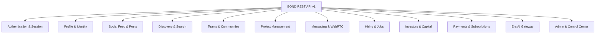
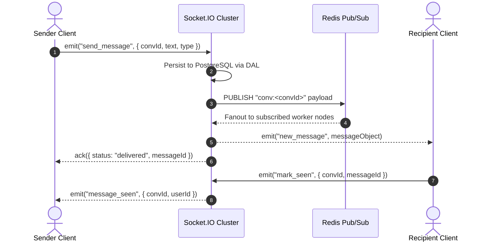

# BOND — API SPECIFICATION & PROTOCOL CONTRACTS
**Document:** API_SPECIFICATION.md  
**Version:** 2.0.0 (Phase 2 Architectural Baseline)  
**Target Platform:** BOND (A Connected Global Digital Ecosystem)  
**Protocol Standard:** RESTful (HTTP/3 & HTTP/2), WebSocket (Socket.IO), Webhooks (HMAC-SHA256)  
**Status:** Architecture Design (Planning Only — Zero Source Code Mutations)  

---

## 1. Global API Standards & Envelope Conventions

BOND adheres to an **API-First Architecture** with deterministic serialization, type-safe validation, standardized error handling, and strict cryptographic idempotency for sensitive operations.

### 1.1 Base URL & Versioning
- **Production Base:** `https://api.bond.global/api/v1`
- **Edge Accelerated Fast-Path:** Intercepted by Cloudflare Pages Functions (`functions/api/[[route]].ts`) for microsecond response times (<15ms).
- **Versioning Strategy:** URI path versioning (`/v1/`). Non-breaking changes are additive; breaking changes mandate a major version increment (`/v2/`).

### 1.2 Unified Response Envelope
Every JSON response adheres to a predictable envelope:

#### Successful Response (`HTTP 200 / 201`)
```json
{
  "success": true,
  "data": {
    "id": "c1f7a28e-49b2-4d1a-8c6e-8d9e2a1b3c4d",
    "name": "Acme Innovations",
    "slug": "acme-innovations"
  },
  "meta": {
    "timestamp": "2026-11-03T18:30:00.000Z",
    "requestId": "req_01jbc28f4k7y8n2m9p1q3r5t7w",
    "pagination": {
      "hasMore": true,
      "cursor": "2026-11-03T17:45:00.000Z_c1f7a28e",
      "limit": 20,
      "total": 142
    }
  }
}
```

#### Error Response (`HTTP 400 / 401 / 403 / 404 / 429 / 500`)
```json
{
  "success": false,
  "error": {
    "code": "VALIDATION_FAILED",
    "message": "The provided payload failed schema validation.",
    "details": [
      {
        "field": "title",
        "issue": "String must contain at least 3 character(s)"
      }
    ]
  },
  "meta": {
    "timestamp": "2026-11-03T18:30:01.000Z",
    "requestId": "req_01jbc28f4k7y8n2m9p1q3r5t7w"
  }
}
```

### 1.3 Standard Error Codes Catalog
| Error Code | HTTP Status | Description |
| :--- | :--- | :--- |
| `UNAUTHORIZED` | 401 | Missing, malformed, or expired authentication token. |
| `FORBIDDEN` | 403 | Authenticated user lacks required platform or organization permissions. |
| `NOT_FOUND` | 404 | Target resource does not exist or has been deleted. |
| `VALIDATION_FAILED` | 400 | Payload rejected by Zod schema validation. |
| `CONFLICT` | 409 | Resource uniqueness violation (e.g. duplicate username or slug). |
| `RATE_LIMITED` | 429 | Rate limit quota exceeded; inspect `Retry-After` header. |
| `IDEMPOTENCY_CONFLICT` | 409 | Request with identical `Idempotency-Key` is currently processing. |
| `INTERNAL_ERROR` | 500 | Unhandled origin failure; recorded in error logs with `requestId`. |

### 1.4 Headers & Authentication
- **Authentication:** `Authorization: Bearer <Access_JWT>`
- **Idempotency:** `Idempotency-Key: <UUIDv4>` (Mandatory for all `POST /api/v1/billing/*` and sensitive mutations).
- **Client Metadata:** `X-BOND-Client-Version: 2.0.0`, `X-BOND-Platform: web|ios|android`.

---

## 2. Comprehensive REST Endpoint Catalog



### 2.1 Authentication & Sessions
- `POST /api/v1/auth/register` — Register a new individual identity.
- `POST /api/v1/auth/login` — Authenticate credentials; returns access token and sets secure refresh cookie.
- `POST /api/v1/auth/refresh` — Rotate refresh token and issue fresh 15-minute access token.
- `POST /api/v1/auth/logout` — Revoke active session and invalidate refresh token.
- `GET /api/v1/auth/sessions` — List active login sessions and devices.
- `DELETE /api/v1/auth/sessions/:id` — Remotely terminate a specific session.
- `POST /api/v1/auth/passkeys/register-options` — Generate WebAuthn passkey registration options.
- `POST /api/v1/auth/passkeys/verify-registration` — Complete passkey registration.

### 2.2 Profile & Identity
- `GET /api/v1/profiles/me` — Fetch authenticated user's primary profile and workspace memberships.
- `PATCH /api/v1/profiles/me` — Update bio, headline, links, and display attributes.
- `GET /api/v1/profiles/:username` — Public profile resolution by unique handle.
- `POST /api/v1/profiles/skills` — Add verified or self-asserted skills.
- `DELETE /api/v1/profiles/skills/:id` — Remove a skill.
- `POST /api/v1/profiles/experiences` — Add employment or advisory experience.
- `POST /api/v1/profiles/verification` — Submit identity verification evidence for verified badge review.

### 2.3 Social Feed & Interactions
- `GET /api/v1/feed/home` — Paginated personalized home feed (Cursor-based: `?cursor=<cursor>&limit=20`).
- `POST /api/v1/posts` — Author a post (Supports markdown, poll attachments, media asset IDs).
- `GET /api/v1/posts/:id` — Retrieve post detail, view count, and top comments.
- `PATCH /api/v1/posts/:id` — Edit post content.
- `DELETE /api/v1/posts/:id` — Soft-delete post.
- `POST /api/v1/posts/:id/like` — Toggle like status (Optimistic with Redis atomic counter).
- `POST /api/v1/posts/:id/bookmark` — Toggle bookmark in user vault.
- `GET /api/v1/posts/:id/comments` — Threaded comments with nested pagination.
- `POST /api/v1/posts/:id/comments` — Add top-level or reply comment.

### 2.4 Discovery & Search
- `GET /api/v1/search?q=<query>&type=all|users|posts|projects|jobs` — Multi-entity full-text search.
- `GET /api/v1/discover/trending` — Top trending topics, hashtags, and discussion threads.
- `GET /api/v1/discover/people` — Suggested professional connections based on graph proximity.

### 2.5 Teams, Communities & Spaces
- `POST /api/v1/spaces` — Create Space (`type: 'group' | 'community' | 'team'`).
- `GET /api/v1/spaces/:id` — Retrieve Space metadata, members, and channel list.
- `PATCH /api/v1/spaces/:id` — Update Space branding, settings, or membership rules.
- `POST /api/v1/spaces/:id/members` — Invite or add members with designated role.
- `DELETE /api/v1/spaces/:id/members/:userId` — Remove or expel member.
- `PATCH /api/v1/spaces/:id/members/:userId/role` — Update role (Owner, Admin, Moderator, Member).

### 2.6 Project Management
- `POST /api/v1/projects` — Create project workspace under user or organization.
- `GET /api/v1/projects/:id` — Fetch project overview, roadmap, and milestone status.
- `POST /api/v1/projects/:id/tasks` — Create task with priority, assignee, and due date.
- `PATCH /api/v1/projects/:id/tasks/:taskId` — Update task status (Backlog, In Progress, Review, Done).
- `POST /api/v1/projects/:id/milestones` — Define project milestone.

### 2.7 Messaging & Real-Time Communication
- `GET /api/v1/chat/conversations` — List active conversations with unread counts and last message previews.
- `POST /api/v1/chat/conversations/direct` — Find or initiate 1-on-1 direct conversation.
- `POST /api/v1/chat/conversations/group` — Create multi-party group chat with initial participants.
- `GET /api/v1/chat/conversations/:id/messages` — Paginated message history.
- `POST /api/v1/chat/conversations/:id/messages` — Send message with media, voice, or poll payload.
- `POST /api/v1/chat/conversations/:id/seen` — Acknowledge message delivery and seen status.
- `DELETE /api/v1/chat/messages/:id` — Unsend message for everyone or delete locally.

### 2.8 Hiring & Talent
- `POST /api/v1/jobs` — Publish job opening or freelance gig.
- `GET /api/v1/jobs` — Filterable job directory (Role, Tech Stack, Compensation, Location).
- `POST /api/v1/jobs/:id/apply` — Submit application with resume asset and cover note.
- `GET /api/v1/hiring/applications` — Employer applicant tracking pipeline.

### 2.9 Investors & Capital Formation
- `POST /api/v1/capital/opportunities` — Configure funding round or grant program.
- `GET /api/v1/capital/opportunities` — Browse accredited investment opportunities.
- `POST /api/v1/capital/pitches` — Submit pitch deck and funding request.

### 2.10 Payments & Billing
- `POST /api/v1/billing/checkout` — Generate checkout session (`Idempotency-Key` required).
- `POST /api/v1/billing/portal` — Retrieve Stripe Customer Portal URL for subscription self-management.
- `GET /api/v1/billing/invoices` — List payment history and downloadable PDF receipts.
- `POST /api/v1/billing/webhooks` — Inbound payment provider webhook endpoint (Stripe, bKash).

### 2.11 Era AI Gateway
- `POST /api/v1/ai/chat` — Streaming conversational assistant (SSE stream).
- `POST /api/v1/ai/summarize` — Generate concise thread or document summary.
- `POST /api/v1/ai/tools/execute` — Execute permitted tool with verified user approval token.

### 2.12 Administration & Control Center
- Direct URLs matching frontend routes:
  - `GET /api/v1/admin/telemetry` (`/admin`) — 5s real-time DAU and system health metrics.
  - `GET /api/v1/admin/users` (`/admin/users`) — Zero-latency user directory.
  - `PATCH /api/v1/admin/users/:id/status` — Moderate user status (Active, Suspended, Banned).
  - `GET /api/v1/admin/reports` (`/admin/reports`) — Content moderation queue.
  - `GET /api/v1/admin/verification` (`/admin/verification`) — Badge approval queue.
  - `GET /api/v1/admin/logs` (`/admin/logs`) — Audit log review.

---

## 3. Real-Time WebSocket Protocol (Socket.IO)



### 3.1 Client to Server Events
- `send_message`: `{ conversationId, content, type, metadata, clientTempId }`
- `typing_start`: `{ conversationId }`
- `typing_stop`: `{ conversationId }`
- `mark_seen`: `{ conversationId, lastMessageId }`
- `call_initiate`: `{ targetUserId, callType: 'audio' | 'video' }`
- `call_signal`: `{ targetUserId, signalData }`

### 3.2 Server to Client Events
- `new_message`: Full message payload with author profile.
- `typing_update`: `{ conversationId, userId, isTyping }`
- `messages_delivered`: `{ conversationId, deliveredToUserId, deliveredAt }`
- `messages_seen`: `{ conversationId, seenByUserId, seenAt }`
- `conversation_created`: Dispatched to all member rooms when a new group is formed.
- `incoming_call`: `{ callId, callerId, callerName, callerPhoto, callType }`

---

## 4. Webhook Inbound & Outbound Architecture

### 4.1 Inbound Webhooks (Stripe / Payment Gateways)
- **Signature Header:** `Stripe-Signature` / `X-Signature-SHA256`
- **Processing Protocol:** Raw body buffered for HMAC signature validation prior to JSON parsing.
- **Idempotency Guarantee:** Event IDs recorded in `payment_events` table; duplicate webhooks immediately return HTTP 200 with zero state modification.

### 4.2 Outbound Webhooks (Developer Platform)
- **Signature:** `X-BOND-Signature: sha256=<HMAC_HEX>` computed with the developer app's client secret.
- **Payload Envelope:** Includes `event`, `timestamp`, `eventId`, and `data`.
- **Delivery Strategy:** Exponential retry policy across 5 attempts (1m, 5m, 30m, 2h, 24h) before marking destination endpoint as disabled.
