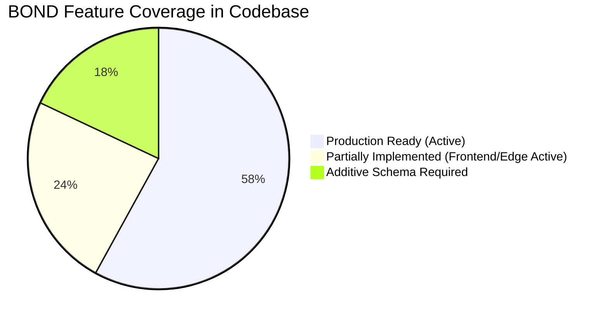

# BOND — ARCHITECTURE GAP ANALYSIS
**Document:** ARCHITECTURE_GAP_ANALYSIS.md  
**Version:** 3.0.0 (Phase 3A Technical Architecture Review)  
**Target Platform:** BOND (A Connected Global Digital Ecosystem)  
**Status:** Complete Gap Assessment  

---

## 1. Executive Summary

This document contrasts the **audited existing Aeirmist codebase** against the **proposed 21 BOND modules** to identify exact implementation deltas, schema additions, and migration safety bounds.

---

## 2. Table-by-Table Architectural Gap Matrix

| Category | Existing in PostgreSQL (34 Tables) | Required Additive Tables for BOND | Gap & Technical Delta |
| :--- | :--- | :--- | :--- |
| **Identity & Users** | `users`, `profiles`, `login_sessions`, `refresh_tokens` | `user_skills`, `user_experiences`, `verification_records` | Currently stored in JSONB fields on `profiles`. Moving to distinct tables enables structured indexing, endorsements, and career filtering. |
| **Social Content** | `posts`, `post_likes`, `post_bookmarks`, `comments`, `comment_likes`, `stories`, `story_highlights`, `videos`, `video_likes`, `video_comments`, `poll_votes` | *None* | 100% covered in existing 34 tables. Zero schema gaps for social feed. |
| **Spaces & Groups** | `conversations`, `conversation_members`, `messages`, `message_reactions`, `calls`, `user_notes`, `vault_items`, `vault_configs` | `space_channels`, `space_invites` | Groups, Communities, and Teams are operational via `conversations.type`. Granular multi-channel spaces will be additive. |
| **Organizations** | `marketplace_stores` | `organizations`, `organization_members` | Storefronts currently exist under `marketplace_stores`. General enterprise organizations will extend this pattern. |
| **Projects & Tasks** | *None* (Notes and Polls active) | `projects`, `project_members`, `tasks`, `milestones` | New additive tables required for project collaboration. Zero conflict with existing tables. |
| **Hiring & Talent** | *None* | `jobs`, `job_applications` | New additive tables required. |
| **Capital & Grants** | *None* | `funding_opportunities`, `funding_requests` | New additive tables required. |
| **Commerce & Billing**| `marketplace_items`, `marketplace_orders` | `subscriptions`, `transactions` | Marketplace catalog and orders are live. Recurring subscription ledger will extend payment capabilities. |
| **Events** | `poll_votes` | `events`, `event_tickets`, `ticket_purchases` | New additive tables required. |
| **Developer Ext** | *None* (REST API v1 active) | `developer_apps`, `api_credentials` | New additive tables required for third-party developer OAuth. |
| **AI Intelligence** | *None* (Era AI routes active) | `ai_conversations`, `ai_messages`, `ai_usage_logs` | Real-time chat is live; persistent token accounting logs will be added. |
| **Administration** | `audit_logs`, `content_reports`, `support_tickets` | `system_flags`, `user_appeals` | Admin Center is live with 12 tabs; appeals table is additive. |

---

## 3. Contradiction & Ambiguity Resolution

1. **Space Channels vs Conversations:**
   - *Ambiguity:* Does a Team space require its own separate database table, or should it leverage `conversations`?
   - *Resolution:* To maintain 100% backward compatibility with mobile and web chat, all spaces continue using `conversations` with `type = 'team' | 'community' | 'group'`. New sub-channels link via `parent_conversation_id`.
2. **Organization vs Storefront:**
   - *Resolution:* `marketplace_stores` remains completely intact for creator shops. Enterprise `organizations` will link to `marketplace_stores` via `organization_id`, ensuring zero breaking changes to existing e-commerce flows.
