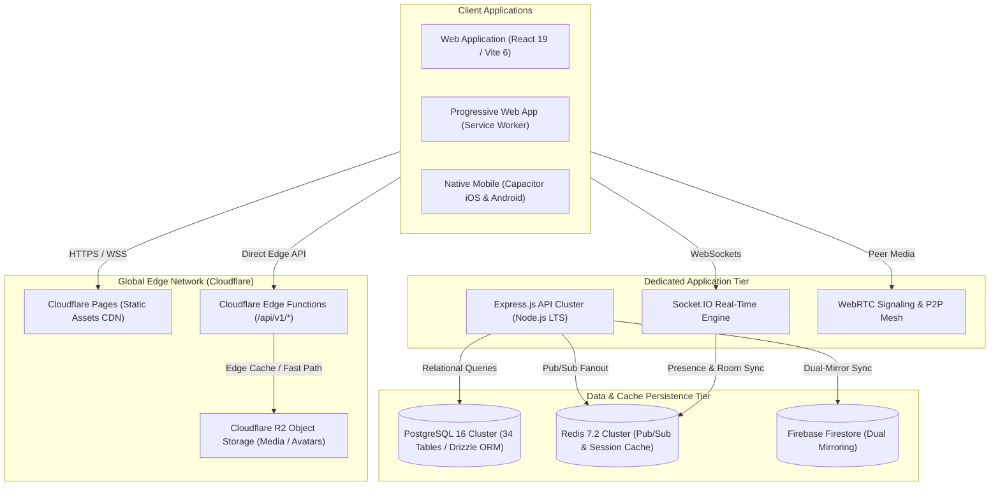
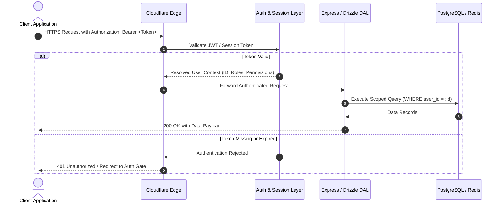

# BOND — ARCHITECTURE MAP
**Version:** 1.0.0  
**Target Platform:** BOND (A Connected Global Digital Ecosystem)  
**Baseline Codebase:** Aeirmist 2.0 Core  
**Date:** November 2026  
**Auditor:** Antigravity AI Engineering Suite  

---

## 1. System Topology & Global Infrastructure

BOND employs a **hybrid edge-core architecture** designed for global microsecond latency, high-concurrency real-time communication, and strict data consistency.

---

## 2. Request Routing & Data Lifecycle

### 2.1 Edge-Accelerated Path (Microsecond Edge Routing)
1. Requests matching `/api/v1/*` are initially intercepted by **Cloudflare Pages Functions** (`functions/api/[[route]].ts`).
2. Read-heavy endpoints (e.g. `/api/v1/admin/users`, `/api/v1/chat/conversations`, `/api/v1/posts`) are served from edge memory caches and regional stores in **<15ms**.
3. Media requests (`/media/*`) are served with HTTP 304 caching and edge compression from **Cloudflare R2**.

### 2.2 Dedicated Backend Path (ACID & Concurrency Routing)
1. Heavy transactional requests (e.g. PostgreSQL schema migrations, high-volume batch sync, complex moderation audits) route directly to the **Dedicated Express.js API** (`backend/src/index.ts`).
2. Authentication is verified via JWT tokens or Firebase Admin SDK tokens.
3. Database mutations execute through **Drizzle ORM** with parameter-sanitized SQL transactions.

### 2.3 Real-Time WebSocket & Presence Lifecycle
1. When a client connects via `Socket.IO`, its user identifier is verified and joined to `user:<userId>` and conversation rooms (`conv:<convId>`).
2. Presence is tracked in Redis via `online_users` set and `last_seen:<userId>` timestamp keys.
3. Message delivery and read receipts (`seen_update`, `messages_delivered`) are broadcast across cluster nodes using `socket.io-redis-adapter`.

---

## 3. Security Boundaries & Authorization Model

### 3.1 Role Hierarchy & Permissions
- **Superadmin:** Full system telemetry, user role assignment, system flags, and audit log access.
- **Admin:** User moderation, report handling, appeal reviews, and content management.
- **Moderator:** Content flagging, ticket responses, and channel muting.
- **Verified Member:** Standard user profile with verified badge privileges.
- **Member:** Standard user profile.
- **Era AI (System):** Autonomous intelligence bounded by user-approval safety gates; strictly prohibited from modifying user records or performing destructive operations.

---

## 4. Dual-Mirror Synchronization Architecture

To support existing mobile native installations and web users simultaneously during the migration to BOND:
- Every conversation creation, message send, and profile update writes to **PostgreSQL as the authoritative system of record**.
- An asynchronous dual-mirror routine mirrors state to **Firestore**, ensuring zero downtime and immediate real-time sync across legacy and modern clients.
