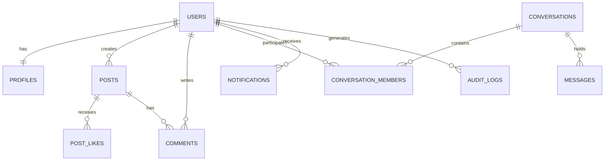

# BOND — DATABASE MAP & SCHEMA CATALOG
**Version:** 1.0.0  
**Target Platform:** BOND (A Connected Global Digital Ecosystem)  
**Baseline Codebase:** Aeirmist 2.0 Core  
**Date:** November 2026  
**Auditor:** Antigravity AI Engineering Suite  

---

## 1. Overview & Dual-Database Paradigm

BOND employs **PostgreSQL** as its primary authoritative ACID-compliant relational store, backed by **Redis** for sub-millisecond caching and real-time state, with **Firestore** mirrored for backward-compatible edge and mobile client synchronization.

---

## 2. PostgreSQL Schema Catalog (34 Tables)

| # | Table Name | Purpose | Primary Key | Key Foreign Keys & Indexes |
| :--- | :--- | :--- | :--- | :--- |
| 1 | `users` | Auth accounts & credentials | `id` (UUID) | Unique `email`, Unique `firebase_uid` |
| 2 | `profiles` | Universal personal identity | `id` (UUID) | FK `user_id` -> `users.id`, Unique `username` |
| 3 | `login_sessions` | Active device sessions | `id` (UUID) | FK `user_id` -> `users.id`, Indexed `token` |
| 4 | `follows` | Follower / following graph | `id` (UUID) | FK `follower_id`, FK `following_id` |
| 5 | `blocks` | User block relationships | `id` (UUID) | FK `blocker_id`, FK `blocked_id` |
| 6 | `posts` | Feed posts & media items | `id` (UUID) | FK `author_id` -> `users.id`, Index `created_at` |
| 7 | `post_likes` | Post likes & reactions | `id` (UUID) | FK `post_id`, FK `user_id` (Unique composite) |
| 8 | `post_bookmarks`| Saved / bookmarked posts | `id` (UUID) | FK `post_id`, FK `user_id` |
| 9 | `comments` | Threaded post comments | `id` (UUID) | FK `post_id`, FK `author_id`, `parent_id` |
| 10| `comment_likes` | Comment like interactions | `id` (UUID) | FK `comment_id`, FK `user_id` |
| 11| `conversations` | 1-on-1, Group, Team, Spaces | `id` (UUID) | Index `type`, Index `updated_at` |
| 12| `conversation_members` | Channel memberships & roles | `id` (UUID) | FK `conversation_id`, FK `user_id`, `role` |
| 13| `messages` | Chat messages & system events | `id` (UUID) | FK `conversation_id`, FK `sender_id`, `created_at` |
| 14| `message_reactions` | Emoji reactions on messages | `id` (UUID) | FK `message_id`, FK `user_id`, `emoji` |
| 15| `media_assets` | Uploaded images, audio, video | `id` (UUID) | FK `uploader_id`, `url`, `mime_type` |
| 16| `notifications` | In-app user notifications | `id` (UUID) | FK `recipient_id`, `is_read`, `created_at` |
| 17| `audit_logs` | Security & admin activity logs | `id` (UUID) | FK `actor_id`, `action`, `created_at` |
| 18| `marketplace_items` | Products, digital goods, tools | `id` (UUID) | FK `seller_id`, `category`, `price` |
| 19| `marketplace_stores` | Creator & enterprise storefronts | `id` (UUID) | FK `owner_id`, Unique `slug` |
| 20| `marketplace_orders` | Orders, billing & fulfillment | `id` (UUID) | FK `buyer_id`, FK `store_id`, `status` |
| 21| `stories` | 24-hour ephemeral stories | `id` (UUID) | FK `author_id`, `expires_at` |
| 22| `story_highlights` | Permanent story collections | `id` (UUID) | FK `author_id`, `title` |
| 23| `videos` | Short-form and long-form video | `id` (UUID) | FK `author_id`, `video_url` |
| 24| `video_likes` | Likes on video content | `id` (UUID) | FK `video_id`, FK `user_id` |
| 25| `video_comments` | Threaded video comments | `id` (UUID) | FK `video_id`, FK `author_id` |
| 26| `calls` | WebRTC audio & video call logs | `id` (UUID) | FK `caller_id`, FK `receiver_id`, `status` |
| 27| `user_notes` | Pinned quick thoughts & notes | `id` (UUID) | FK `user_id`, `created_at` |
| 28| `vault_items` | Encrypted private safe items | `id` (UUID) | FK `user_id`, `cipher_text` |
| 29| `vault_configs` | User vault passkeys & hashes | `id` (UUID) | FK `user_id` (Unique) |
| 30| `poll_votes` | Votes on feed and group polls | `id` (UUID) | FK `poll_id`, FK `user_id` |
| 31| `support_tickets` | User helpdesk & support inbox | `id` (UUID) | FK `user_id`, `status`, `priority` |
| 32| `content_reports` | Moderation & safety reports | `id` (UUID) | FK `reporter_id`, `status`, `target_id` |
| 33| `refresh_tokens` | Secure token refresh chains | `id` (UUID) | FK `user_id`, `token_hash`, `expires_at` |
| 34| `push_subscriptions` | WebPush & mobile push tokens | `id` (UUID) | FK `user_id`, `endpoint` |

---

## 3. Redis In-Memory Data Topology

- **`online_users` (Set):** Tracks active user IDs currently connected to WebSockets.
- **`last_seen:<userId>` (String):** Epoch millisecond timestamp of last interaction.
- **`chat_rate:<userId>` (Counter with 60s TTL):** Anti-spam rate limiting on message sends.
- **`typing:<convId>:<userId>` (String with 5s TTL):** Active typing presence indicator.
- **`cache:user:<userId>` (Hash with 300s TTL):** Cached profile object for microsecond lookups.

---

## 4. Firestore Dual-Mirror Collections (21 Collections)

Mirrored for backward compatibility with native mobile apps and edge fallbacks:
`users`, `profiles`, `posts`, `comments`, `conversations`, `conversations/{id}/messages`, `notifications`, `stories`, `reports`, `support_tickets`, `marketplace_items`, `calls`, `vault`, `notes`, `polls`, `audit_logs`, `system_flags`, `appeals`, `verification_requests`, `device_tokens`, `chat_settings`.
