# BOND — DATABASE SCHEMA & LOGICAL DATA ARCHITECTURE
**Document:** DATABASE_SCHEMA.md  
**Version:** 2.0.0 (Phase 2 Architectural Baseline)  
**Target Platform:** BOND (A Connected Global Digital Ecosystem)  
**Engine:** PostgreSQL 16 (Authoritative ACID Store) with Drizzle ORM  
**Status:** Architecture Design (Planning Only — Zero Source Code Mutations)  

---

## 1. Architectural Principles & Invariants

1. **One Person, One Primary Personal Identity:** Every registered human possesses exactly one record in `users` and one record in `profiles`. Organizational workspaces, startups, agencies, teams, and communities are distinct entities (`organizations`, `teams`, `projects`) linked to user accounts via relational membership records (`organization_members`, `team_members`, `project_members`). Users never create duplicate personal accounts for organizational personas.
2. **ACID Authoritative System of Record:** PostgreSQL is the singular authoritative source of truth. Redis acts as a cache and transient state manager; Firestore acts as a legacy real-time shim during migration.
3. **Non-Destructive Additive Evolution:** All schema enhancements are strictly additive. Column renaming, dropping, or table truncation are permanently forbidden in production.
4. **Consistent Primary Keys:** All primary keys utilize RFC 4122 Version 4 UUIDs (`uuid_generate_v4()` or `gen_random_uuid()`) to support distributed creation, offline sync, and secure enumeration prevention.
5. **Deterministic Auditability:** Every mutable entity contains `created_at` and `updated_at` timestamps (UTC `timestamptz`), with soft deletion via `deleted_at` where historical retention is mandatory.

---

## 2. Global Entity-Relationship Diagram

```mermaid
erDiagram
    USERS ||--|| PROFILES : "has one primary identity"
    USERS ||--o{ USER_SKILLS : "possesses"
    USERS ||--o{ USER_EXPERIENCES : "records"
    USERS ||--o{ VERIFICATION_RECORDS : "evaluated by"
    USERS ||--o{ LOGIN_SESSIONS : "authenticates via"
    
    USERS ||--o{ POSTS : "authors"
    POSTS ||--o{ MEDIA_ASSETS : "contains"
    POSTS ||--o{ COMMENTS : "receives"
    POSTS ||--o{ POST_LIKES : "liked by"
    POSTS ||--o{ POST_BOOKMARKS : "saved by"
    
    USERS ||--o{ FOLLOWS : "follows / followed by"
    USERS ||--o{ CONNECTIONS : "connects with"
    
    ORGANIZATIONS ||--o{ ORGANIZATION_MEMBERS : "employs / includes"
    USERS ||--o{ ORGANIZATION_MEMBERS : "belongs to"
    
    ORGANIZATIONS ||--o{ PROJECTS : "owns"
    USERS ||--o{ PROJECTS : "creates"
    PROJECTS ||--o{ PROJECT_MEMBERS : "collaborates in"
    PROJECTS ||--o{ TASKS : "tracks"
    PROJECTS ||--o{ MILESTONES : "aims for"
    
    COMMUNITIES ||--o{ COMMUNITY_MEMBERS : "gathers"
    TEAMS ||--o{ TEAM_MEMBERS : "collaborates"
    
    CONVERSATIONS ||--o{ CONVERSATION_MEMBERS : "includes"
    CONVERSATIONS ||--o{ MESSAGES : "contains"
    MESSAGES ||--o{ MESSAGE_REACTIONS : "receives"
    
    ORGANIZATIONS ||--o{ JOBS : "publishes"
    JOBS ||--o{ JOB_APPLICATIONS : "receives"
    USERS ||--o{ JOB_APPLICATIONS : "submits"
    
    INVESTOR_PROFILES ||--o{ FUNDING_OPPORTUNITIES : "evaluates"
    PROJECTS ||--o{ FUNDING_REQUESTS : "requests"
    
    ORGANIZATIONS ||--o{ EVENTS : "hosts"
    EVENTS ||--o{ EVENT_TICKETS : "offers"
    USERS ||--o{ TICKET_PURCHASES : "attends via"
    
    COURSES ||--o{ COURSE_MODULES : "contains"
    USERS ||--o{ COURSE_ENROLLMENTS : "learns from"
    
    USERS ||--o{ SUBSCRIPTIONS : "subscribes to"
    USERS ||--o{ TRANSACTIONS : "conducts"
    
    DEVELOPER_APPS ||--o{ API_CREDENTIALS : "holds"
    USERS ||--o{ AUDIT_LOGS : "triggers"
```

---

## 3. Detailed Table Specifications

### 3.1 Identity, Authentication & Credentials

#### `users` (Core Account Credentials)
- **Primary Key:** `id` UUID PRIMARY KEY DEFAULT gen_random_uuid()
- **Columns:**
  - `email` VARCHAR(255) UNIQUE NOT NULL
  - `password_hash` VARCHAR(255) NULL (Null for OAuth/Passkey-only users)
  - `firebase_uid` VARCHAR(128) UNIQUE NULL
  - `role` VARCHAR(32) NOT NULL DEFAULT 'member' CHECK (role IN ('superadmin', 'admin', 'staff', 'member', 'guest'))
  - `is_verified` BOOLEAN NOT NULL DEFAULT false
  - `is_active` BOOLEAN NOT NULL DEFAULT true
  - `is_banned` BOOLEAN NOT NULL DEFAULT false
  - `ban_reason` TEXT NULL
  - `mfa_enabled` BOOLEAN NOT NULL DEFAULT false
  - `mfa_secret` VARCHAR(128) NULL
  - `created_at` TIMESTAMPTZ NOT NULL DEFAULT NOW()
  - `updated_at` TIMESTAMPTZ NOT NULL DEFAULT NOW()
- **Indexes:** `idx_users_email` (BTREE), `idx_users_firebase_uid` (HASH), `idx_users_role` (BTREE)
- **Data Ownership:** Owned by the user; administrative access governed by RBAC.

#### `profiles` (One Person, One Primary Identity)
- **Primary Key:** `id` UUID PRIMARY KEY DEFAULT gen_random_uuid()
- **Foreign Keys:** `user_id` UUID UNIQUE NOT NULL REFERENCES users(id) ON DELETE CASCADE
- **Columns:**
  - `username` VARCHAR(64) UNIQUE NOT NULL
  - `display_name` VARCHAR(128) NOT NULL
  - `headline` VARCHAR(255) NULL
  - `bio` TEXT NULL
  - `avatar_key` TEXT NULL
  - `banner_key` TEXT NULL
  - `location` VARCHAR(128) NULL
  - `website_url` VARCHAR(255) NULL
  - `badge` VARCHAR(32) NULL CHECK (badge IN ('verified', 'admin', 'staff', 'creator', 'investor', 'developer'))
  - `account_id` VARCHAR(64) UNIQUE NULL (Public numerical/alphanumeric identifier)
  - `theme_settings` JSONB NOT NULL DEFAULT '{}'::jsonb
  - `privacy_settings` JSONB NOT NULL DEFAULT '{"is_private": false, "show_activity": true}'::jsonb
  - `created_at` TIMESTAMPTZ NOT NULL DEFAULT NOW()
  - `updated_at` TIMESTAMPTZ NOT NULL DEFAULT NOW()
- **Indexes:** `idx_profiles_username` (LOWER UNIQUE BTREE), `idx_profiles_account_id` (BTREE), `idx_profiles_display_name_trgm` (GIN trigram)
- **Constraints:** Username must match `^[a-z0-9_]{3,30}$`.

#### `user_skills` (Professional Competencies)
- **Primary Key:** `id` UUID PRIMARY KEY DEFAULT gen_random_uuid()
- **Foreign Keys:** `profile_id` UUID NOT NULL REFERENCES profiles(id) ON DELETE CASCADE
- **Columns:**
  - `name` VARCHAR(64) NOT NULL
  - `category` VARCHAR(64) NOT NULL DEFAULT 'general'
  - `endorsement_count` INTEGER NOT NULL DEFAULT 0
  - `created_at` TIMESTAMPTZ NOT NULL DEFAULT NOW()
- **Indexes:** `idx_user_skills_profile_id` (BTREE), `idx_user_skills_name` (BTREE)

#### `user_experiences` (Work & Career History)
- **Primary Key:** `id` UUID PRIMARY KEY DEFAULT gen_random_uuid()
- **Foreign Keys:** `profile_id` UUID NOT NULL REFERENCES profiles(id) ON DELETE CASCADE
- **Columns:**
  - `company_name` VARCHAR(128) NOT NULL
  - `role_title` VARCHAR(128) NOT NULL
  - `employment_type` VARCHAR(32) NOT NULL DEFAULT 'full_time'
  - `start_date` DATE NOT NULL
  - `end_date` DATE NULL
  - `is_current` BOOLEAN NOT NULL DEFAULT false
  - `description` TEXT NULL
  - `created_at` TIMESTAMPTZ NOT NULL DEFAULT NOW()
- **Indexes:** `idx_user_experiences_profile_id` (BTREE)

#### `verification_records` (Identity Authenticity Evidence)
- **Primary Key:** `id` UUID PRIMARY KEY DEFAULT gen_random_uuid()
- **Foreign Keys:** 
  - `user_id` UUID NOT NULL REFERENCES users(id) ON DELETE CASCADE
  - `reviewed_by` UUID NULL REFERENCES users(id) ON DELETE SET NULL
- **Columns:**
  - `document_type` VARCHAR(32) NOT NULL CHECK (document_type IN ('government_id', 'business_license', 'domain_verification', 'professional_cert'))
  - `document_key` TEXT NOT NULL (Encrypted Cloudflare R2 reference)
  - `status` VARCHAR(32) NOT NULL DEFAULT 'pending' CHECK (status IN ('pending', 'approved', 'rejected', 'revoked'))
  - `rejection_reason` TEXT NULL
  - `reviewed_at` TIMESTAMPTZ NULL
  - `created_at` TIMESTAMPTZ NOT NULL DEFAULT NOW()
- **Indexes:** `idx_verification_user_id` (BTREE), `idx_verification_status` (BTREE)
- **Retention:** Approved documents encrypted with AES-256; purged 90 days post-verification per privacy laws.

---

### 3.2 Social Graph, Content & Interactions

#### `posts` (Social Content & Updates)
- **Primary Key:** `id` UUID PRIMARY KEY DEFAULT gen_random_uuid()
- **Foreign Keys:** `author_id` UUID NOT NULL REFERENCES users(id) ON DELETE CASCADE
- **Columns:**
  - `content` TEXT NOT NULL
  - `media_urls` JSONB NOT NULL DEFAULT '[]'::jsonb
  - `visibility` VARCHAR(32) NOT NULL DEFAULT 'public' CHECK (visibility IN ('public', 'connections', 'private', 'space'))
  - `space_id` UUID NULL (References teams or communities if published inside a Space)
  - `like_count` INTEGER NOT NULL DEFAULT 0
  - `comment_count` INTEGER NOT NULL DEFAULT 0
  - `repost_count` INTEGER NOT NULL DEFAULT 0
  - `is_pinned` BOOLEAN NOT NULL DEFAULT false
  - `created_at` TIMESTAMPTZ NOT NULL DEFAULT NOW()
  - `updated_at` TIMESTAMPTZ NOT NULL DEFAULT NOW()
  - `deleted_at` TIMESTAMPTZ NULL
- **Indexes:** `idx_posts_author_created` (BTREE on `author_id, created_at DESC`), `idx_posts_created_at` (BTREE DESC), `idx_posts_space_id` (BTREE)

#### `media_assets` (Images, Video & Binary Files)
- **Primary Key:** `id` UUID PRIMARY KEY DEFAULT gen_random_uuid()
- **Foreign Keys:** `uploader_id` UUID NOT NULL REFERENCES users(id) ON DELETE CASCADE
- **Columns:**
  - `r2_key` TEXT UNIQUE NOT NULL
  - `file_name` VARCHAR(255) NOT NULL
  - `mime_type` VARCHAR(128) NOT NULL
  - `file_size_bytes` BIGINT NOT NULL
  - `sha256_hash` VARCHAR(64) NOT NULL
  - `width` INTEGER NULL
  - `height` INTEGER NULL
  - `duration_seconds` NUMERIC(8,2) NULL
  - `created_at` TIMESTAMPTZ NOT NULL DEFAULT NOW()
- **Indexes:** `idx_media_uploader_id` (BTREE), `idx_media_sha256` (HASH)

#### `comments` (Threaded Discussion)
- **Primary Key:** `id` UUID PRIMARY KEY DEFAULT gen_random_uuid()
- **Foreign Keys:** 
  - `post_id` UUID NOT NULL REFERENCES posts(id) ON DELETE CASCADE
  - `author_id` UUID NOT NULL REFERENCES users(id) ON DELETE CASCADE
  - `parent_comment_id` UUID NULL REFERENCES comments(id) ON DELETE CASCADE
- **Columns:**
  - `content` TEXT NOT NULL
  - `like_count` INTEGER NOT NULL DEFAULT 0
  - `created_at` TIMESTAMPTZ NOT NULL DEFAULT NOW()
  - `updated_at` TIMESTAMPTZ NOT NULL DEFAULT NOW()
  - `deleted_at` TIMESTAMPTZ NULL
- **Indexes:** `idx_comments_post_created` (BTREE on `post_id, created_at ASC`), `idx_comments_parent` (BTREE)

#### `post_likes` & `post_bookmarks`
- **Primary Key:** `id` UUID PRIMARY KEY DEFAULT gen_random_uuid()
- **Foreign Keys:** `post_id` UUID REFERENCES posts(id) ON DELETE CASCADE, `user_id` UUID REFERENCES users(id) ON DELETE CASCADE
- **Constraints:** UNIQUE (`post_id`, `user_id`)

#### `follows` & `connections` (Social Graph)
- **`follows` (Asymmetric):** `(follower_id, following_id)` UNIQUE composite, indexed both directions.
- **`connections` (Mutual / Professional):** `(user_a_id, user_b_id, status)` where status IN ('pending', 'connected', 'declined'), enforced ordered `user_a_id < user_b_id` constraint to eliminate duplicate pairs.

---

### 3.3 Organizations, Teams & Projects

#### `organizations` (Companies, Agencies, Startups, DAOs)
- **Primary Key:** `id` UUID PRIMARY KEY DEFAULT gen_random_uuid()
- **Foreign Keys:** `owner_id` UUID NOT NULL REFERENCES users(id) ON DELETE RESTRICT
- **Columns:**
  - `slug` VARCHAR(64) UNIQUE NOT NULL
  - `name` VARCHAR(128) NOT NULL
  - `headline` VARCHAR(255) NULL
  - `description` TEXT NULL
  - `logo_key` TEXT NULL
  - `banner_key` TEXT NULL
  - `website_url` VARCHAR(255) NULL
  - `verified_tier` VARCHAR(32) NOT NULL DEFAULT 'unverified' CHECK (verified_tier IN ('unverified', 'verified_org', 'enterprise'))
  - `created_at` TIMESTAMPTZ NOT NULL DEFAULT NOW()
  - `updated_at` TIMESTAMPTZ NOT NULL DEFAULT NOW()
- **Indexes:** `idx_orgs_slug` (BTREE), `idx_orgs_owner_id` (BTREE)

#### `organization_members` (Organizational RBAC)
- **Primary Key:** `id` UUID PRIMARY KEY DEFAULT gen_random_uuid()
- **Foreign Keys:** 
  - `organization_id` UUID NOT NULL REFERENCES organizations(id) ON DELETE CASCADE
  - `user_id` UUID NOT NULL REFERENCES users(id) ON DELETE CASCADE
- **Columns:**
  - `role` VARCHAR(32) NOT NULL DEFAULT 'member' CHECK (role IN ('owner', 'admin', 'recruiter', 'member', 'billing'))
  - `joined_at` TIMESTAMPTZ NOT NULL DEFAULT NOW()
- **Constraints:** UNIQUE (`organization_id`, `user_id`)

#### `projects` (Collaborative Deliverables & Initiatives)
- **Primary Key:** `id` UUID PRIMARY KEY DEFAULT gen_random_uuid()
- **Foreign Keys:** 
  - `creator_id` UUID NOT NULL REFERENCES users(id) ON DELETE RESTRICT
  - `organization_id` UUID NULL REFERENCES organizations(id) ON DELETE SET NULL
- **Columns:**
  - `title` VARCHAR(128) NOT NULL
  - `slug` VARCHAR(64) UNIQUE NOT NULL
  - `description` TEXT NOT NULL
  - `status` VARCHAR(32) NOT NULL DEFAULT 'active' CHECK (status IN ('draft', 'active', 'paused', 'completed', 'archived'))
  - `visibility` VARCHAR(32) NOT NULL DEFAULT 'public' CHECK (visibility IN ('public', 'private', 'unlisted'))
  - `budget_currency` VARCHAR(3) NOT NULL DEFAULT 'USD'
  - `budget_amount` NUMERIC(12,2) NULL
  - `created_at` TIMESTAMPTZ NOT NULL DEFAULT NOW()
  - `updated_at` TIMESTAMPTZ NOT NULL DEFAULT NOW()
- **Indexes:** `idx_projects_slug` (BTREE), `idx_projects_org` (BTREE), `idx_projects_creator` (BTREE)

#### `tasks` & `milestones`
- **`tasks`:** `(id, project_id, assignee_id, title, description, status, priority, due_date, created_at, updated_at)`
- **`milestones`:** `(id, project_id, title, due_date, status, completion_percentage)`

---

### 3.4 Real-Time Communication & Spaces

#### `conversations` (Channels & Chat Spaces)
- **Primary Key:** `id` UUID PRIMARY KEY DEFAULT gen_random_uuid()
- **Columns:**
  - `type` VARCHAR(32) NOT NULL DEFAULT 'direct' CHECK (type IN ('direct', 'group', 'community', 'team', 'self'))
  - `title` VARCHAR(128) NULL
  - `avatar_key` TEXT NULL
  - `is_vaulted` BOOLEAN NOT NULL DEFAULT false
  - `settings` JSONB NOT NULL DEFAULT '{}'::jsonb
  - `last_message_preview` TEXT NULL
  - `last_message_at` TIMESTAMPTZ NULL
  - `created_at` TIMESTAMPTZ NOT NULL DEFAULT NOW()
  - `updated_at` TIMESTAMPTZ NOT NULL DEFAULT NOW()
- **Indexes:** `idx_conversations_type` (BTREE), `idx_conversations_last_msg` (BTREE DESC)

#### `conversation_members` (Participation & Seen State)
- **Primary Key:** `id` UUID PRIMARY KEY DEFAULT gen_random_uuid()
- **Foreign Keys:** 
  - `conversation_id` UUID NOT NULL REFERENCES conversations(id) ON DELETE CASCADE
  - `user_id` UUID NOT NULL REFERENCES users(id) ON DELETE CASCADE
- **Columns:**
  - `role` VARCHAR(32) NOT NULL DEFAULT 'member' CHECK (role IN ('owner', 'admin', 'moderator', 'member'))
  - `unread_count` INTEGER NOT NULL DEFAULT 0
  - `is_muted` BOOLEAN NOT NULL DEFAULT false
  - `is_pinned` BOOLEAN NOT NULL DEFAULT false
  - `last_read_at` TIMESTAMPTZ NULL
  - `joined_at` TIMESTAMPTZ NOT NULL DEFAULT NOW()
- **Constraints:** UNIQUE (`conversation_id`, `user_id`)
- **Indexes:** `idx_conv_members_user` (BTREE), `idx_conv_members_conv` (BTREE)

#### `messages` (Chat Records)
- **Primary Key:** `id` UUID PRIMARY KEY DEFAULT gen_random_uuid()
- **Foreign Keys:** 
  - `conversation_id` UUID NOT NULL REFERENCES conversations(id) ON DELETE CASCADE
  - `sender_id` UUID NOT NULL REFERENCES users(id) ON DELETE CASCADE
- **Columns:**
  - `content` TEXT NOT NULL
  - `type` VARCHAR(32) NOT NULL DEFAULT 'text' CHECK (type IN ('text', 'image', 'audio', 'video', 'file', 'system', 'poll'))
  - `metadata` JSONB NOT NULL DEFAULT '{}'::jsonb
  - `expires_at` TIMESTAMPTZ NULL (Vanishing Mode expiration)
  - `created_at` TIMESTAMPTZ NOT NULL DEFAULT NOW()
  - `updated_at` TIMESTAMPTZ NOT NULL DEFAULT NOW()
  - `deleted_at` TIMESTAMPTZ NULL
- **Indexes:** `idx_messages_conv_created` (BTREE on `conversation_id, created_at DESC`), `idx_messages_expires_at` (BTREE WHERE expires_at IS NOT NULL)

---

### 3.5 Capital, Jobs, Commerce & Events

#### `funding_opportunities` & `funding_requests`
- **`funding_opportunities`:** Configured by accredited investors and grant makers with investment tickets, industry focus, and criteria.
- **`funding_requests`:** Submitted by verified projects seeking investment with milestone schedules and funding goals.

#### `jobs` & `job_applications`
- **`jobs`:** `(id, organization_id, title, description, employment_type, remote_policy, location, min_salary, max_salary, currency, status, created_at)`
- **`job_applications`:** `(id, job_id, applicant_id, resume_key, cover_note, status, created_at)`

#### `events` & `event_tickets`
- **`events`:** `(id, organizer_id, title, start_time, end_time, is_virtual, stream_url, venue_address, capacity, created_at)`
- **`event_tickets`:** `(id, event_id, name, price, currency, quantity_available, quantity_sold)`
- **`ticket_purchases`:** `(id, ticket_id, user_id, transaction_id, qr_code_hash, status, created_at)`

#### `subscriptions` & `transactions` (Financial Ledger)
- **`subscriptions`:** `(id, user_id, plan_id, status, current_period_start, current_period_end, cancel_at_period_end, external_stripe_id)`
- **`transactions`:** `(id, user_id, amount, currency, status, type, external_provider, external_id, idempotency_key, created_at)`
- **Constraints:** `idempotency_key` UNIQUE NOT NULL on transactions to prevent double charges.

---

### 3.6 Developer Platform, AI & Administration

#### `developer_apps` & `api_credentials`
- **`developer_apps`:** `(id, owner_id, app_name, client_id, client_secret_hash, redirect_uris, scopes, created_at)`
- **`api_credentials`:** `(id, app_id, key_hash, label, rate_limit_rpm, is_active, created_at)`

#### `ai_conversations` & `ai_messages`
- **`ai_conversations`:** `(id, user_id, title, model_tier, context_tokens, created_at)`
- **`ai_messages`:** `(id, conversation_id, role, content, tool_calls, tokens_used, created_at)`

#### `audit_logs` (Immutable Security Ledger)
- **Primary Key:** `id` UUID PRIMARY KEY DEFAULT gen_random_uuid()
- **Columns:**
  - `actor_id` UUID NULL REFERENCES users(id) ON DELETE SET NULL
  - `action` VARCHAR(64) NOT NULL
  - `target_type` VARCHAR(64) NOT NULL
  - `target_id` VARCHAR(128) NOT NULL
  - `details` JSONB NOT NULL DEFAULT '{}'::jsonb
  - `ip_address` VARCHAR(45) NOT NULL
  - `user_agent` TEXT NOT NULL
  - `created_at` TIMESTAMPTZ NOT NULL DEFAULT NOW()
- **Indexes:** `idx_audit_actor` (BTREE), `idx_audit_action` (BTREE), `idx_audit_created` (BTREE DESC)
- **Retention:** Append-only; zero updates or deletes permitted; partitioned by month for high performance.
