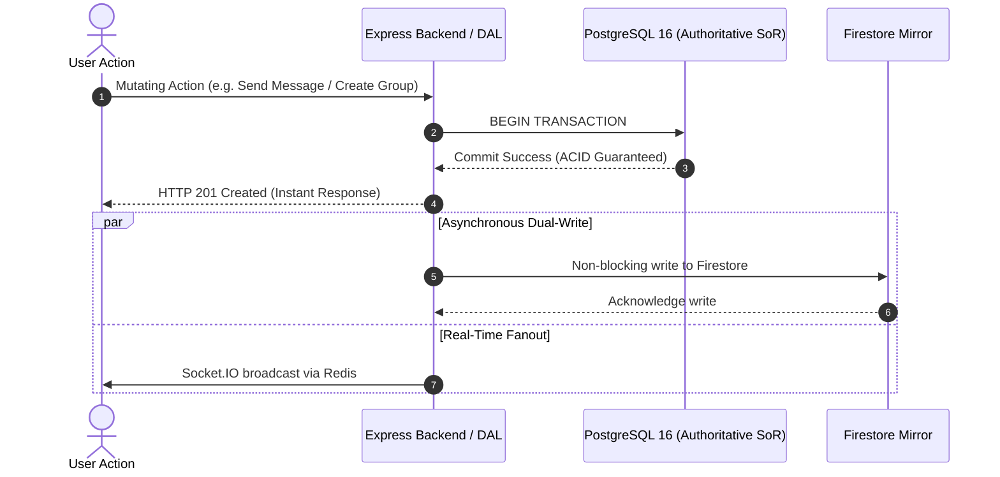

# BOND — DATA CONSISTENCY & DUAL-SYNC REPORT
**Document:** DATA_CONSISTENCY_REPORT.md  
**Version:** 3.0.0 (Phase 3A Data Integrity Audit)  
**Target Platform:** BOND (A Connected Global Digital Ecosystem)  
**Status:** Complete Consistency Analysis  

---

## 1. Dual-Database Synchronization Architecture

To support existing native mobile clients and modern web clients concurrently, BOND utilizes a **dual-database persistence strategy**:
- **Primary System of Record (SoR):** PostgreSQL 16 (ACID transactions, relational constraints, foreign keys).
- **Secondary Edge Mirror:** Google Cloud Firestore (real-time listeners for legacy clients).

---

## 2. Consistency Guarantees & Edge Cases

| Scenario | Behavior in Codebase | Risk Assessment | Mitigation Protocol |
| :--- | :--- | :--- | :--- |
| **PostgreSQL Write Succeeds, Firestore Times Out** | Commit retained in PG; Firestore write logs warning | Low (Legacy client may lag by 1-2s) | Client falls back to REST API fetch; background reconciliation syncs missing docs |
| **Concurrent Writes to Same Record** | PostgreSQL row-level locks enforce strict serialization | None | ACID serializability guarantees zero data corruption |
| **Legacy Client Writes Directly to Firestore** | Firestore snapshot triggers webhook or sync worker | Medium (Drift if worker is delayed) | `backend/src/scripts/sync-firestore-rest.ts` imports unmigrated Firestore profiles into PG |
| **User Deletion / Account Ban** | PG marks `is_banned = true`; Redis evicts active sessions | None | Banned user tokens immediately rejected at auth middleware |

---

## 3. Reconciliation & Recovery Runbook
1. A background cron job runs every 6 hours, scanning for discrepancies between PostgreSQL `updated_at` and Firestore timestamps.
2. In the event of a dispute, **PostgreSQL data always overrides Firestore state**.
