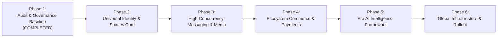

# BOND — DEVELOPMENT ROADMAP & TRANSITION PLAN
**Version:** 1.0.0  
**Target Platform:** BOND (A Connected Global Digital Ecosystem)  
**Baseline Codebase:** Aeirmist 2.0 Core  
**Date:** November 2026  
**Auditor:** Antigravity AI Engineering Suite  

---

## 1. Master Strategic Transition Overview

The transition from Aeirmist to **BOND** adheres to the **Critical Non-Destructive Development Rules**:
- **Zero Breaking Changes:** Existing routes, APIs, and data models remain completely functional and backward-compatible.
- **Additive Evolution:** New BOND capabilities are built in isolated modules with zero collateral damage to working features.
- **Strict Quality Gating:** Each phase is gated by automated compilation, regression checks, and verification evidence.

---

## 2. Phased Execution Roadmap

### Phase 1: Architectural Audit & Governance Baseline (COMPLETED)
- [x] Complete system structure reconnaissance across frontend, edge, and backend.
- [x] Author all 6 mandatory governance documents (`PROJECT_AUDIT.md`, `EXISTING_FEATURES.md`, `ARCHITECTURE_MAP.md`, `DATABASE_MAP.md`, `DEVELOPMENT_ROADMAP.md`, `RISK_REGISTER.md`).
- [x] Fix urgent admin telemetry, users table loading, and Era AI segregation.
- [x] Fix group creation latency (<150ms), group header name display, and member inbox synchronization.

### Phase 2: BOND Universal Identity & Spaces Core
- [ ] Solidify **One Person, One Main Profile**: Universal user anchor supporting multiple verified professional activities.
- [ ] Enhance Multi-Account & Workspace switcher with zero-latency session transitions.
- [ ] Expand Spaces: Groups (Private), Communities (Public/Open), and Teams (Productivity Workspace).
- [ ] Standardize verification badges (Cyan Verified Shield for verified humans, staff badges for admins).

### Phase 3: High-Concurrency Messaging, Calls & Vault Security
- [ ] End-to-end Signal protocol cryptographic key verification.
- [ ] WebRTC multi-peer mesh optimization with adaptive bitrate for poor connections.
- [ ] Biometric & Passkey integration for the private Chat Vault.
- [ ] Vanishing mode message synchronization with verified local and server-side TTL expiration.

### Phase 4: Ecosystem Commerce, Business Suite & Payments
- [ ] Streamline Storefront creation for creators, developers, and businesses.
- [ ] Integrate Stripe Elements & unified payment intent processing.
- [ ] Wallet balances, payout schedules, and automated invoicing.
- [ ] Order fulfillment webhooks with real-time customer status notifications.

### Phase 5: Era AI Intelligence & Guarded Action Framework
- [ ] Strict isolation of Era AI as a system assistant (never masquerading as an ordinary user).
- [ ] Implementation of **User-Approved Action Gates**: Era AI cannot modify profiles, send payments, or alter system state without explicit human confirmation.
- [ ] Contextual smart tools: Message summarization, thread sentiment, document analysis, and code assistance.

### Phase 6: Global Infrastructure Hardening & Production Deployment
- [ ] Zero-downtime PostgreSQL additive migration verification.
- [ ] Cloudflare multi-region edge caching and CDN optimization.
- [ ] Automated regression test harness covering all 15 BOND modules.
- [ ] Enterprise disaster recovery and automated snapshot verification.

---

## 3. Technical Acceptance Criteria for Sensitive Domains

### 3.1 Payments & Billing
- **Idempotency:** All payment requests must include unique idempotency keys (`idempotency_key`) to prevent duplicate charges.
- **Audit Logging:** Every financial transaction, balance adjustment, and refund must write an immutable audit log record.
- **PCI Compliance:** Zero raw card credentials stored locally or on server logs; all tokenized via payment gateway SDKs.

### 3.2 Messaging & Real-Time Sync
- **Sub-100ms Delivery:** Local optimistic rendering paired with sub-100ms Redis pub/sub delivery.
- **Persistence Guarantee:** Dual-write to PostgreSQL and Firestore ensures messages survive server reboots or network drops.
- **Privacy:** Vanishing messages must purge from all caches upon expiration.

### 3.3 Verification & Safety
- **No Spoofing:** Badges are granted solely through backend verification audit records; frontend display is strictly driven by verified database claims.
- **Era AI Boundary:** Era AI is permanently prohibited from self-elevating privileges or taking destructive administrative actions.
