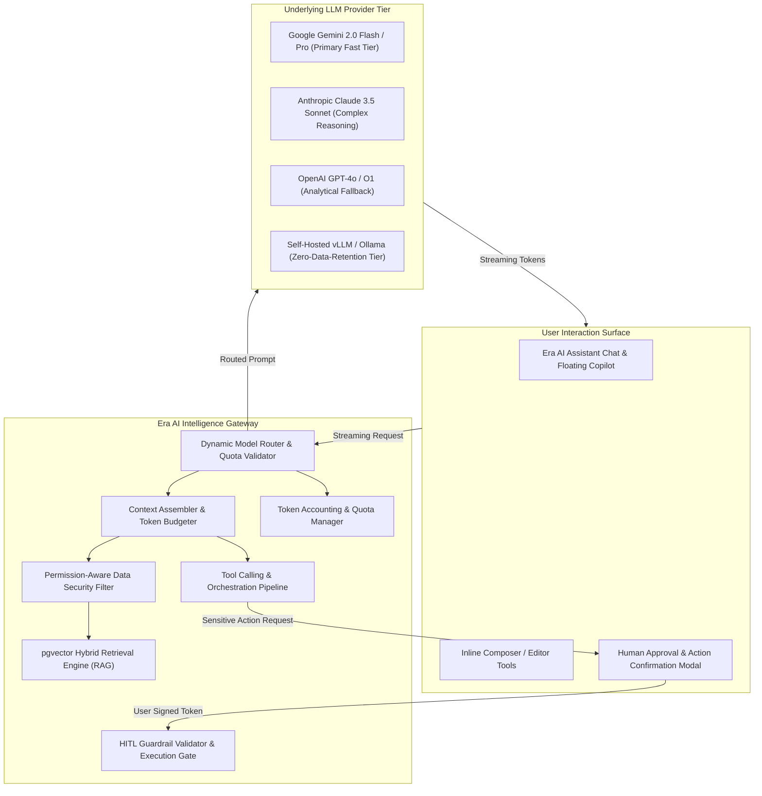
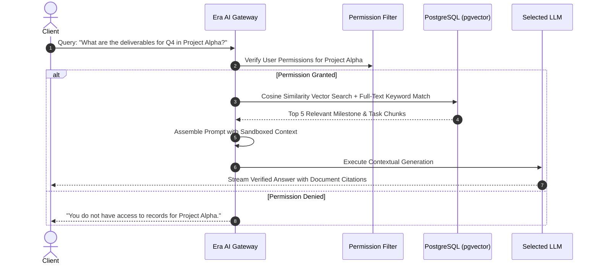
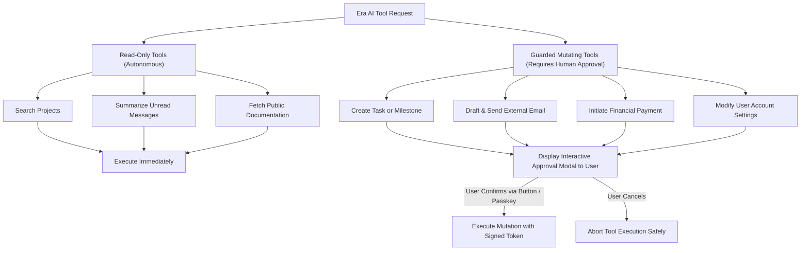

# BOND — ERA AI ARCHITECTURE & INTELLIGENCE GATEWAY
**Document:** ERA_AI_ARCHITECTURE.md  
**Version:** 2.0.0 (Phase 2 Architectural Baseline)  
**Target Platform:** BOND (A Connected Global Digital Ecosystem)  
**Classification:** Provider-Independent Contextual Intelligence Specification  
**Status:** Architecture Design (Planning Only — Zero Source Code Mutations)  

---

## 1. Executive Summary & Governance Invariants

**Era AI** is the contextual intelligence layer of the BOND ecosystem. It is designed to empower user productivity, discover connections, summarize knowledge, draft communications, and assist in workspace coordination.

### 1.1 Fundamental Safety & Identity Invariants
1. **Era AI is a System Assistant, Not an Ordinary User:** Era AI operates under a dedicated system principal (`00000000-0000-4000-a000-000000000001`). It is permanently segregated from human user directories, administrative user tables, and human social rankings.
2. **Mandatory Human-in-the-Loop (HITL) Guardrail:** Era AI is strictly prohibited from executing financial transactions, modifying user credentials, altering access permissions, deleting resources, or performing external communications without explicit, interactive human confirmation.
3. **Verified Information vs AI Assessment Separation:** AI-generated evaluations, summaries, and recommendations must be visually distinct, labeled with an `[AI Assessment]` indicator, and never merged into cryptographically verified user claims.
4. **Provider-Independent Abstraction:** Core application code communicates exclusively with the internal Era AI Gateway, abstracting underlying LLM vendors (Google Gemini, Anthropic Claude, OpenAI, and open-source models).

---

## 2. Era AI System Architecture



---

## 3. Dynamic Model Routing & Provider Fallback

BOND avoids vendor lock-in through a **tiered capability routing matrix**:

| Tier | Primary Provider | Fallback Provider | Use Case | Latency Target |
| :--- | :--- | :--- | :--- | :--- |
| **Tier 1 (Instant Conversational)** | Gemini 2.0 Flash | Claude 3.5 Haiku | Real-time chat, autocomplete, short replies | <250ms (First token) |
| **Tier 2 (Analytical & Reasoning)** | Claude 3.5 Sonnet | Gemini 2.0 Pro | Long-form drafting, contract review, project breakdown | <600ms |
| **Tier 3 (Zero-Retention / Private)**| Local vLLM (Llama 3.3) | Self-Hosted Mistral | Private Vault document analysis, confidential deal rooms | <800ms |

### Fallback Circuit Breaker
If the Primary Provider returns an HTTP 429 (Rate Limit), HTTP 500, or fails to respond within 3.5 seconds, the Era AI Gateway instantly retries with the Fallback Provider without dropping the client stream.

---

## 4. Context Management & Retrieval-Augmented Generation (RAG)

### 4.1 Hybrid Retrieval Architecture
To answer questions about projects, community discussions, or documentation, Era AI leverages a hybrid RAG pipeline:



### 4.2 Permission-Aware Data Security Filtering
- **Strict User Impersonation:** RAG queries pass the authenticated user's session context into the database search query.
- The retrieval query enforces:
  ```sql
  SELECT chunk_text, 1 - (embedding <=> :query_vector) AS similarity
  FROM knowledge_embeddings
  WHERE (space_id IN (SELECT space_id FROM space_members WHERE user_id = :current_user_id)
     OR visibility = 'public')
  ORDER BY similarity DESC
  LIMIT 5;
  ```
- **Zero Data Leakage:** A user cannot extract information via Era AI that they do not possess authorization to view directly through the UI.

---

## 5. Tool Execution & Human-in-the-Loop (HITL) Guardrails

Era AI tools are categorized into **Safe (Read-Only)** and **Guarded (State-Mutating)**:



### 5.1 Guarded Action Contract
When an AI agent determines that a state mutation is required:
1. It emits an `action_proposal` event containing the exact parameters, target ID, and potential impact.
2. The client UI renders an **Interactive Action Card** requiring explicit user click confirmation.
3. The server only executes the tool when presented with an ephemeral HMAC-signed `approval_token` generated by the user's interactive confirmation.
4. **Permanent Prohibitions:** Era AI can **NEVER** initiate fund transfers, password updates, or administrative user bans, even with prompt injection attempts.

---

## 6. Token Accounting, Quotas & Cost Monitoring

### 6.1 Usage Tiers & Rate Limiting
- **Free Members:** 50,000 Era AI tokens / month (Tier 1 models only).
- **Pro Subscribers:** 1,000,000 tokens / month (Tier 1 & Tier 2 models).
- **Team & Enterprise Workspaces:** Pooled workspace quotas with custom overage controls.

### 6.2 Telemetry & Token Tracking
- Every AI interaction writes to the `ai_usage_logs` table:
  - `user_id`, `organization_id`, `model_used`, `prompt_tokens`, `completion_tokens`, `cost_usd`, `duration_ms`.
- Users can inspect their current token consumption directly within their Profile Settings.

---

## 7. Auditability & Separation of Claims

- **Clear Attribution:** Responses that synthesize user data include clickable source citations: `[Source: Project Alpha / Milestone 2]`.
- **Untrusted Content Sanitization:** AI responses are scrubbed against prompt-injection attempts before parsing into client components.
- **Evaluation Pipeline:** Periodic automated synthetic evaluations benchmark accuracy, hallucination rates, and prompt injection resistance.
