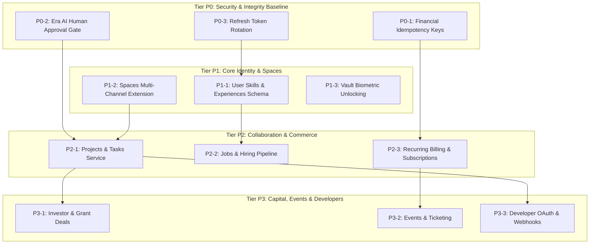

# BOND — IMPLEMENTATION DEPENDENCY GRAPH
**Document:** IMPLEMENTATION_DEPENDENCY_GRAPH.md  
**Version:** 3.0.0 (Phase 3A Dependency Analysis)  
**Target Platform:** BOND (A Connected Global Digital Ecosystem)  
**Status:** Complete Dependency Graph  

---

## 1. Visual Dependency Roadmap

---

## 2. Invariant: Zero Circular Dependencies
All modules adhere to a strictly acyclic dependency graph. The foundational Identity and Auth layers have zero dependencies on downstream modules. Ancillary capabilities (such as Developer Webhooks or Event Ticketing) can be disabled without impacting core social or messaging functionality.
