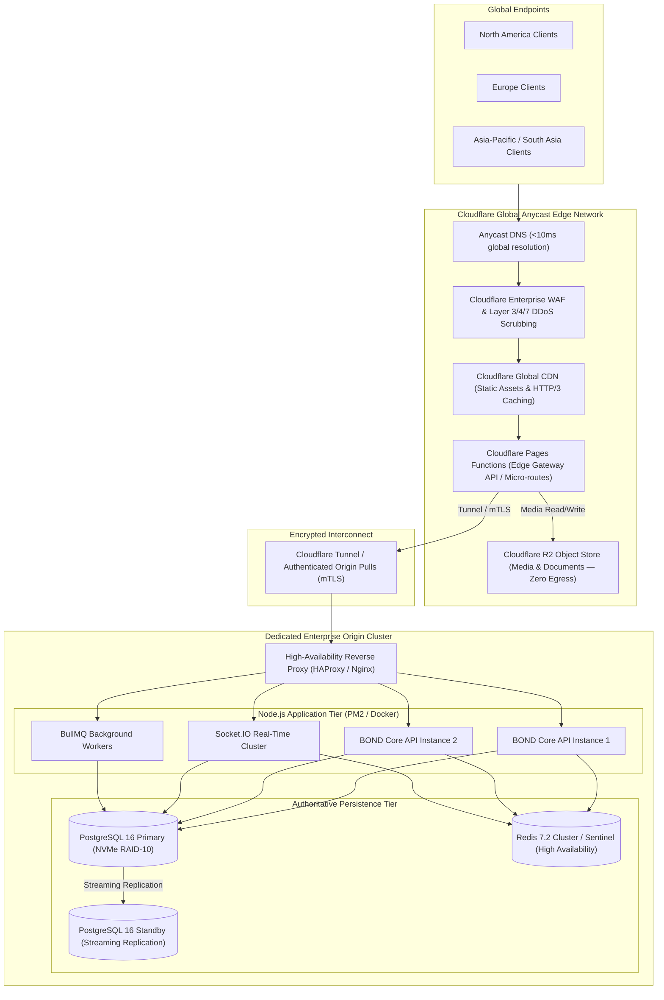
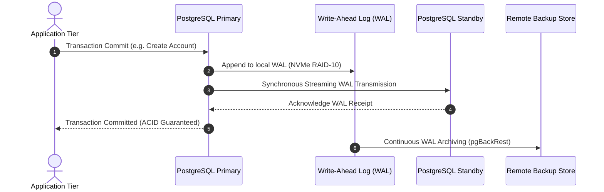

# BOND — INFRASTRUCTURE, NETWORKING & DISASTER RECOVERY PLAN
**Document:** INFRASTRUCTURE_PLAN.md  
**Version:** 2.0.0 (Phase 2 Architectural Baseline)  
**Target Platform:** BOND (A Connected Global Digital Ecosystem)  
**Infrastructure Model:** Hybrid Edge-Accelerated Dedicated Host Infrastructure  
**Status:** Architecture Design (Planning Only — Zero Source Code Mutations)  

---

## 1. Executive Summary & Infrastructure Philosophy

BOND utilizes a **Hybrid Dedicated Server + Cloudflare Global Edge** architecture. This pairs the ultra-low latency, global DDoS scrubbing, WAF filtering, and zero-egress media storage of Cloudflare's Edge with the raw computational power, deterministic cost structure, and data sovereignty of dedicated physical origin servers.

### 1.1 Non-Negotiable Invariants
- **Cloudflare Does Not Replace the Primary Database or Application Host:** PostgreSQL 16 operates on dedicated bare-metal / enterprise hosts with NVMe drives; Express application instances execute on dedicated Node.js clusters.
- **Zero Exposed Origin Ports:** Origin servers do not expose HTTP/HTTPS ports directly to the public internet. All inbound traffic routes through **Cloudflare Authenticated Origin Pulls (AOP)** or **Cloudflare Tunnels (cloudflared)**.

---

## 2. Global Network Topology

---

## 3. Dedicated Origin Hardware Specifications

### 3.1 Primary Application & Database Host (Primary Production)
- **CPU:** AMD EPYC 9354 (32 Cores, 64 Threads, 3.25GHz base)
- **RAM:** 256 GB ECC DDR5
- **Storage:** 4x 3.84 TB Enterprise NVMe U.2 (Hardware RAID-10 for database storage) + 2x 960 GB NVMe (OS RAID-1)
- **Networking:** Dual 10 Gbps bonded uplinks (Redundant switches)
- **Host OS:** Ubuntu Server 24.04 LTS (HWE Kernel, tuned TCP BBR)

### 3.2 High-Availability Secondary Host (Hot Standby / Replicas)
- Identical hardware profile in an isolated physical availability zone.
- Maintains continuous synchronous streaming replication from the primary database.

---

## 4. Origin Security & Network Hardening

1. **Cloudflare Tunnel (`cloudflared`):**
   - Outbound-only encrypted TLS connections established from origin to Cloudflare edge daemon points.
   - Origin firewall (`nftables` / `ufw`) blocks all inbound public traffic on ports 80/443; zero open public listening ports.
2. **Mutual TLS (mTLS):**
   - Direct IP connections, if utilized, strictly require Cloudflare Authenticated Origin Pull client certificates signed by Cloudflare CA.
3. **Internal WireGuard Mesh:**
   - Dedicated servers interconnect across secure encrypted WireGuard tunnels (`10.100.0.0/16`) for database replication and Redis clustering.

---

## 5. Storage Architecture & Cloudflare R2 Integration

- **Zero Egress Billing:** Media assets, story videos, user avatars, and private Vault blobs reside in Cloudflare R2.
- **Bucket Organization:**
  - `bond-media-public`: Public post images, avatars, community logos. Served via Cloudflare CDN with `Cache-Control: public, max-age=31536000, immutable`.
  - `bond-documents-private`: Verification files, resumes, enterprise deal rooms. Accessed exclusively via time-limited presigned GET URLs (60-second TTL).
- **Chunked Resumable Uploads:** Multipart uploads coordinated directly between the client and R2 using S3-compatible APIs.

---

## 6. High Availability & Database Replication

- **Failover Mechanism:** Automated failover managed by **Patroni** with distributed consensus via **etcd**. If primary host becomes unreachable for >10 seconds, Patroni automatically promotes the Standby to Primary and updates application connection routing.
- **Connection Pooling:** **PgBouncer** configured on each application host with transaction pooling (`pool_mode = transaction`), managing up to 10,000 concurrent client connections with 100 dedicated database backend connections.

---

## 7. Automated Backup Architecture

| Backup Tier | Frequency | Mechanism | Retention | Storage Location |
| :--- | :--- | :--- | :--- | :--- |
| **Continuous WAL** | Real-Time | `pgBackRest` / WAL-G streaming | 30 Days (Point-In-Time) | Encrypted Cloudflare R2 |
| **Full Snapshot** | Daily (02:00 UTC)| Physical LVM / NVMe snapshot | 90 Days | Offsite Dedicated Host |
| **Redis State** | Hourly | RDB Snapshots + AOF (`everysec`) | 7 Days | Local Disk + Backup Host |
| **Configuration** | On Git Commit | Encrypted Ansible / Terraform state| Unlimited | Version Controlled Vault |

### Point-In-Time Recovery (PITR)
Enables database restoration to any exact second within the past 30 days in the event of logical corruption or operational error.

---

## 8. Observability & Monitoring Infrastructure

- **Metrics Collection:** **Prometheus** scraping node exporters, PostgreSQL (`postgres_exporter`), Redis (`redis_exporter`), and Nginx metrics at 15-second intervals.
- **Dashboards:** **Grafana** enterprise dashboards monitoring CPU, NVMe IOPS, query latency p95/p99, active WebSocket connections, and Edge cache hit ratios.
- **Application Performance Monitoring (APM):** **OpenTelemetry** SDK with distributed trace propagation across Edge Functions and Core API.
- **Error Tracking:** **Sentry** self-hosted instance capturing uncaught client and server exceptions with full stack traces and request IDs.
- **Alerting Escalation:** Alertmanager dispatching P1 alerts to on-call engineers via PagerDuty / Telegram webhook for:
  - Host memory usage > 90% for > 5 minutes.
  - Database replication lag > 10MB or > 5 seconds.
  - API HTTP 5xx error rate > 1% over 3 minutes.
  - Cloudflare origin health check failure.

---

## 9. Disaster Recovery Plan & Runbook

### Recovery Objectives
- **Recovery Time Objective (RTO):** < 30 Minutes.
- **Recovery Point Objective (RPO):** < 5 Minutes (Typically < 1 second via continuous WAL streaming).

### Failure Scenarios & Runbooks
1. **Primary Database Host Crash:**
   - Patroni detects heartbeat loss; promotes hot standby within 15 seconds.
   - PgBouncer reroutes pool connections seamlessly; zero data loss.
2. **Total Datacenter Outage:**
   - Cloudflare Tunnel automatically flips origin routing to secondary datacenter host.
   - Standby database in secondary datacenter becomes active master.
   - Point-in-time recovery validates data consistency against last R2 WAL archive.
3. **Ransomware / Catastrophic Volume Loss:**
   - Stand up new bare-metal instance via automated Terraform / Ansible playbook.
   - Pull baseline snapshot from encrypted R2 backup repository.
   - Replay WAL delta files up to the moment prior to the incident.
