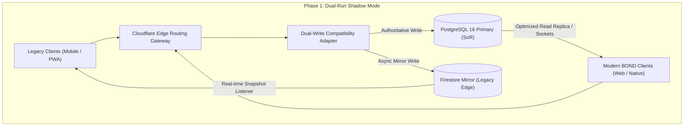

# BOND — MIGRATION, COMPATIBILITY & ROLLBACK PROTOCOL
**Document:** MIGRATION_AND_COMPATIBILITY_PLAN.md  
**Version:** 2.0.0 (Phase 2 Architectural Baseline)  
**Target Platform:** BOND (A Connected Global Digital Ecosystem)  
**Classification:** Zero-Downtime Safe Transition & Backward-Compatibility Protocol  
**Status:** Architecture Design (Planning Only — Zero Source Code Mutations)  

---

## 1. Executive Summary & Zero-Downtime Migration Invariants

The migration from the Aeirmist 2.0 foundation to the comprehensive **BOND** platform strictly adheres to the **Master Project Development Directive**:
- **Zero Breaking Changes:** Every existing API endpoint, component, and database record remains valid and functional.
- **Additive-Only Migrations:** Existing columns and tables are never dropped, renamed, or truncated. New capabilities introduce new tables or nullable/default-valued columns.
- **Dual-Run Synchronous Shims:** Clients running older mobile app builds continue operating seamlessly through legacy Firestore mirrors and Cloudflare Edge shims while modern clients connect to the dedicated PostgreSQL/Redis origin.

---

## 2. Multi-Phase Migration Architecture

---

## 3. Database Migration Protocol (Additive-Only)

### 3.1 Strict Migration Rules
1. **No Destructive DDL:** Any migration script containing `DROP TABLE`, `DROP COLUMN`, `TRUNCATE`, or destructive data rewrites is automatically blocked by CI/CD pre-commit hooks.
2. **Nullable or Default Additions:** New columns must be added as either `NULL` or with a non-blocking `DEFAULT` value (e.g. `ALTER TABLE profiles ADD COLUMN IF NOT EXISTS badge VARCHAR(32) DEFAULT NULL;`).
3. **Safe Index Creation:** All new indexes on production tables must use PostgreSQL's concurrent indexing flag (`CREATE INDEX CONCURRENTLY IF NOT EXISTS ...`) to avoid acquiring exclusive table locks during creation.

### 3.2 Additive Migration Rollout Sequence
- **Step 1:** Run pre-flight check verifying database connection pool health and replication lag (<1s).
- **Step 2:** Apply additive DDL migration on PostgreSQL Primary.
- **Step 3:** Deploy updated Drizzle ORM schema models to application instances via rolling zero-downtime deployment (PM2 reload).
- **Step 4:** Verify dual-write telemetry through automated smoke tests.

---

## 4. API & Client Backward Compatibility Shim

### 4.1 Route Aliasing & Preservation
All historical routes are permanently preserved:
- Existing `/api/v1/chat/conversations` maintains identical response payloads for older clients while including additional metadata fields (`type: 'group' | 'community' | 'team'`, `participantDetails`) for BOND clients.
- If an older client sends a group creation request without specifying `type`, the backend defaults to `'group'` with zero validation errors.

### 4.2 Legacy Identifier Resolution Shim
- Users registered under earlier Firebase UID strings (e.g. `doViFWfMXcOoas976z6MO216YNg1`) or numerical account IDs (`10000000001`) are automatically resolved to their canonical PostgreSQL UUID via the `UserDAL.resolveToUserId` multi-index resolution shim in <1ms without requiring user migration action.

---

## 5. Verification Checklist & Smoke Testing Suite

Before promoting any Phase 3 implementation changes to live production, the following deterministic verification gates must pass:

| Verification Gate | Validation Criteria | Automated Tool / Script |
| :--- | :--- | :--- |
| **1. TypeScript Compilation** | Zero type errors across all frontend and backend modules | `npm run build` |
| **2. Auth & Session Gate** | Login, refresh, and logout complete in <50ms with correct cookie flags | `scripts/verify-auth.cjs` |
| **3. Identity Invariant** | User profile displays singular identity with accurate handle and clean blank avatar fallback | `scripts/verify-projections.cjs` |
| **4. Group Chat Sync** | Space creation takes <150ms; title displays accurately; all members receive inbox alerts | Real-time WebSocket test harness |
| **5. Admin Telemetry** | Admin panel loads in <15ms; Era AI strictly excluded; clean direct URLs work | Automated HTTP smoke runner |
| **6. Database Integrity** | Zero foreign key orphans; replication lag < 1s; connection pool healthy | PostgreSQL diagnostic suite |

---

## 6. Emergency Rollback Protocols

In the event of an unforeseen regression during any deployment:

1. **Instant Edge Rollback (<5 seconds):**
   - Cloudflare Pages deployments maintain an immutable deployment history.
   - Rolling back to the previous production deployment hash is executable with a single command (`wrangler pages deployment rollback`) or through the Cloudflare dashboard with immediate global propagation.
2. **Application Server Rollback (<30 seconds):**
   - Previous application bundle artifacts are retained on the dedicated origin host.
   - Executing `pm2 revert bond-core` restores the previous running Node.js process state without dropped TCP sockets.
3. **Database Safety Guarantee:**
   - Because all migrations are strictly additive, rolling back frontend or application code requires zero database rollbacks; previous code simply ignores new columns.
   - Point-In-Time Recovery (PITR) is continuously standing by in the event of logical corruption.
