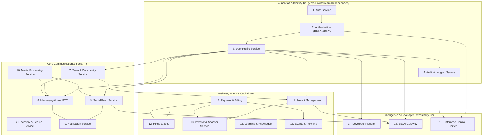
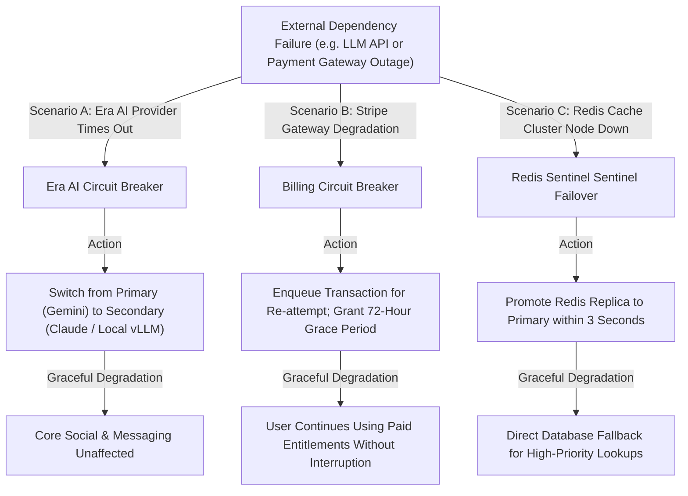

# BOND — MODULE DEPENDENCY MAP & INTERFACE CONTRACTS
**Document:** MODULE_DEPENDENCY_MAP.md  
**Version:** 2.0.0 (Phase 2 Architectural Baseline)  
**Target Platform:** BOND (A Connected Global Digital Ecosystem)  
**Classification:** Inter-Service Dependency & Fault-Isolation Topology  
**Status:** Architecture Design (Planning Only — Zero Source Code Mutations)  

---

## 1. Executive Summary & Coupling Principles

To achieve high agility without microservice operational complexity, BOND employs a **Modular Monolith Architecture** with strictly enforced interface contracts:
- **Loose Coupling:** Modules interact via clearly defined internal service interfaces or asynchronous events. Direct arbitrary imports across domain boundaries are forbidden.
- **Fail-Safe Isolation:** A failure in an ancillary module (e.g. Era AI model timeout, video transcoding backlog) must never crash or block critical user workflows (authentication, messaging, profile inspection).

---

## 2. Global Module Dependency Graph

---

## 3. Detailed Service Dependency & Communication Matrix

| Service | Primary Inbound Dependencies | Outbound Dependencies | Communication Style | Isolation Mechanism |
| :--- | :--- | :--- | :--- | :--- |
| **Auth** | Client Login/Register, Developer OAuth | Database (`users`, `sessions`), Redis | Synchronous HTTP | Fails closed; Rate limited in Redis |
| **Authorization** | All Protected Endpoints | Database (`roles`), In-Memory Bitmask | Synchronous In-Process | Fails closed (403 Forbidden) |
| **Profile** | Feed, Search, Chat, Spaces, Hiring | Media Service, Database (`profiles`) | Synchronous + Redis Cache | Cached reads; Stale cache fallback |
| **Social Feed** | Client Feed Views, User Profiles | Profile, Media, Notification, BullMQ | Sync Reads + Async Fanout | Chronological fallback if scoring fails |
| **Search** | Client Search, Autocomplete | Read Replica Database, GIN Indexes | Synchronous Read-Only | Read replica pool; Debounced queries |
| **Spaces (Teams)**| Client Space Nav, Project Management | Profile, Notification, Chat | Synchronous State Sync | Optimistic client state; Local cache |
| **Messaging** | Client Chat, WebRTC Calling | Socket.IO, Redis Pub/Sub, Notification | Full-Duplex WebSocket | Local queue with retry; Zero drop |
| **Notification** | Social, Messaging, Projects, Billing | BullMQ, WebPush, FCM, APNs, SMTP | Asynchronous Queue | Dead-letter queue with exponential retry |
| **Media** | Post Composer, Avatar Upload, Chat | Cloudflare R2, Sharp Worker Pool | Presigned Direct-to-R2 | Async transcoding; Direct client upload |
| **Projects** | Team Spaces, Client Roadmaps | Spaces, Profiles, Notification | Synchronous HTTP + WebSockets| Board state cached in Redis |
| **Hiring** | Job Seekers, Employers | Profile, Organization, Notification | Synchronous HTTP | Search offloaded to read replica |
| **Capital** | Startup Founders, Investors | Project, Organization, Verification | Synchronous ACID Transactions| Strict row-level database locking |
| **Billing** | Client Checkout, Stripe Webhooks | PostgreSQL Ledger, Gateway SDKs | Sync Intent + Async Webhook | Mandatory `Idempotency-Key` headers |
| **Era AI** | Floating Copilot, Inline Tools | LLM Vendors, pgvector, Core API | Streaming SSE / WebSockets | Multi-model fallback; Circuit breaker |
| **Admin** | Enterprise Control Center | All System Tables, Redis Telemetry | Synchronous High-Privilege | Dedicated read replica queries |

---

## 4. Failure Cascade Analysis & Circuit Breakers

### Circuit Breaker Rules:
1. **Threshold:** If an external downstream service (e.g. external LLM or Email SMTP) fails 5 consecutive times within a 30-second window, the circuit breaker **Trips Open**.
2. **Half-Open Probe:** After 60 seconds, a single test probe request is dispatched. If successful, the circuit resets to **Closed**; if it fails, the circuit remains Open for another 120 seconds.
3. **Core Isolation:** Zero third-party service failures can cause an HTTP 500 error on core personal profile, feed, or chat delivery routes.
