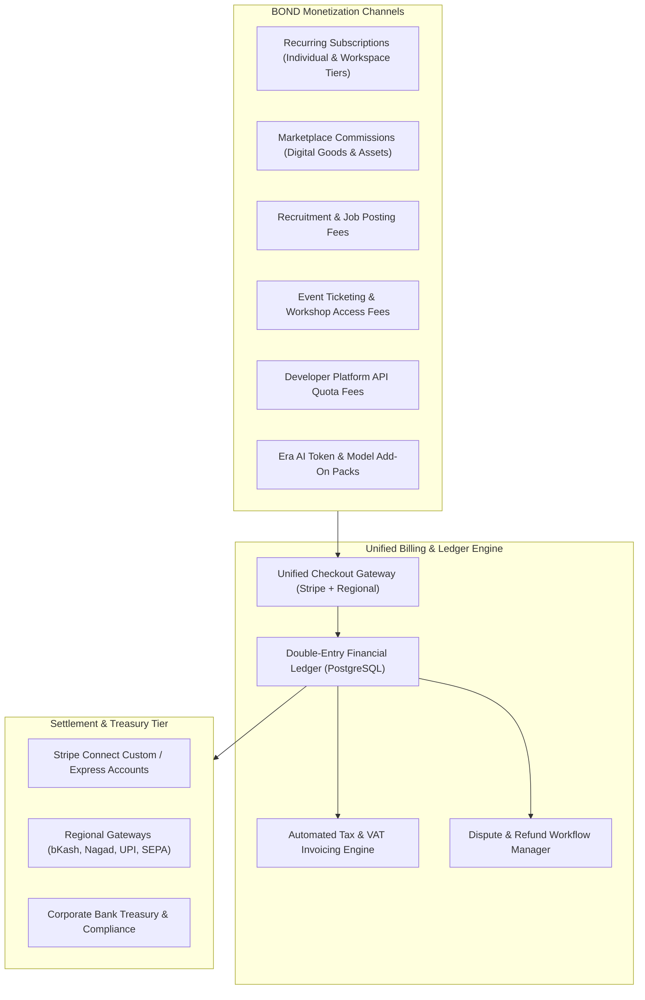
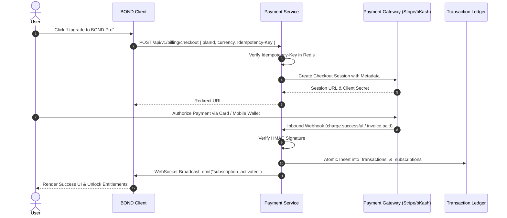

# BOND — MONETIZATION, BILLING & FINANCIAL COMPLIANCE ARCHITECTURE
**Document:** MONETIZATION_ARCHITECTURE.md  
**Version:** 2.0.0 (Phase 2 Architectural Baseline)  
**Target Platform:** BOND (A Connected Global Digital Ecosystem)  
**Infrastructure:** Stripe Billing, Regional Payment Connectors, Ledger Engine  
**Status:** Architecture Design (Planning Only — Zero Source Code Mutations)  

---

## 1. Executive Summary & Monetization Philosophy

BOND's business model is built on **diversified, transparent monetization** that scales alongside user success. Rather than relying on intrusive user surveillance or advertising, BOND generates revenue through value-added subscriptions, marketplace commissions, recruitment tooling, capital formation fees, and developer platform usage.

---

## 2. Subscription Tiers & Entitlement Matrix

BOND separates individual personal identity subscriptions from organizational workspace plans:

| Plan Identifier | Target Persona | Billing Interval | Key Capabilities & Entitlements | Price (Indicative) |
| :--- | :--- | :--- | :--- | :--- |
| **BOND Free** | Standard Human Identity | Free Forever | Public profile, social feed, direct messaging, basic search, 50k Era AI tokens/mo | $0 |
| **BOND Premium** | Individual Power Users | Monthly / Annual | Verified Human Badge, priority discovery, uncompressed media, 1M Era AI tokens/mo, custom profile themes | $9.99 / mo |
| **BOND Pro** | Freelancers & Creators | Monthly / Annual | Portfolio analytics, unlimited proposals, storefront creation, custom domain mapping, 3M Era AI tokens | $24.99 / mo |
| **BOND Team** | Startups & Project Teams | Per seat / mo | Team Spaces, shared Kanban roadmaps, private deal rooms, pooled 10M AI tokens, role permissions | $15 / seat / mo |
| **BOND Enterprise** | Organizations & Companies| Custom Annual | Dedicated account manager, SSO/SAML, custom data retention, custom SLA, unmetered AI gateway | Custom Quote |
| **Era AI Pack** | Add-on Quota (All users)| Pay-as-you-go | Extra 5,000,000 tokens for Era AI reasoning models | $10 / pack |

---

## 3. Transactional & Marketplace Revenue Capabilities

### 3.1 Digital Marketplace Services
- **Platform Take-Rate:** 8% platform fee on digital templates, 3D assets, UI kits, design systems, and software licenses sold in the BOND Marketplace.
- **Creator Payouts:** Funds held in escrow until delivery confirmation (automatic clearance after 7 days without dispute). Transferred via Stripe Connect or regional bank payouts.

### 3.2 Recruitment & Talent Acquisition
- **Job Postings:** $99 per 30-day verified job listing; includes AI candidate matching and applicant filtering.
- **Direct Candidate Sourcing:** Pro recruiters purchase monthly InMail and contact access packages.

### 3.3 Event Ticketing
- **Platform Fee:** 3.5% + $0.50 per paid ticket for conferences, hackathons, and virtual workshops. Free events incur zero platform fee.

### 3.4 Developer Platform Monetization
- Third-party applications integrating BOND Graph APIs receive 10,000 free API calls / month; tier-based pricing thereafter ($0.002 per billable API call).

---

## 4. Multi-Gateway Payment Architecture

### 4.1 Global Gateways (Stripe)
- Primary engine for North America, Europe, and international card networks (Visa, Mastercard, Amex, Apple Pay, Google Pay).
- Handles automated recurring billing, SCA 3D-Secure 2.0 verification, and customer self-service portal.

### 4.2 Regional Payment Connectors
- **South Asia (Bangladesh / India):** Integrated local wallets (**bKash**, **Nagad**, **UPI**) via localized edge adaptors to capture high-growth emerging digital economies.
- **Europe:** SEPA direct debit and iDEAL.
- **Currency Isolation:** Transactions settle in primary local currencies (USD, EUR, GBP, BDT, INR) without double-conversion penalties.

---

## 5. Financial Compliance, Tax & Invoicing

### 5.1 Global Indirect Tax Calculation (VAT / GST / Sales Tax)
- Integration with **Stripe Tax** dynamically calculates and applies appropriate tax rates based on the customer's billing address and business tax exemption ID (EU VAT, UK VAT, US State Sales Tax).
- Invoices store distinct line items: `subtotal`, `tax_amount`, `tax_rate_percent`, `total`.

### 5.2 Immutable Financial Ledger Design
- The `transactions` table operates under strict double-entry ledger principles:
  - Balances cannot be updated via arithmetic overwrite; every balance shift requires an explicit offsetting debit/credit transaction record.
  - Transactions require an immutable `idempotency_key` preventing network retries from executing multiple charges.

### 5.3 Dispute, Chargeback & Refund Protocols
- **Webhooks:** Inbound `charge.dispute.created` automatically flags the user's account and notifies the billing operations team.
- **Grace Period:** Subscriptions enter a 3-day `past_due` grace period during billing retries before access to paid features is restricted, ensuring uninterrupted user experience.
