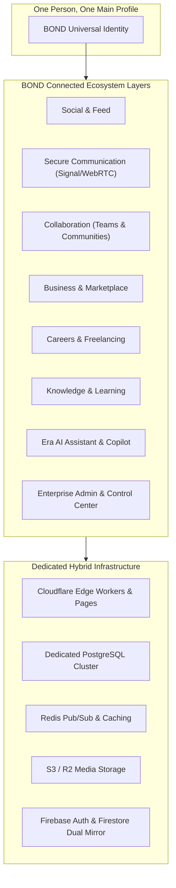
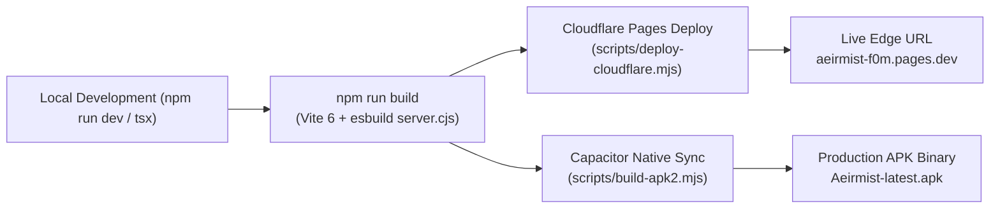

# BOND — PROJECT AUDIT
**Version:** 1.0.0  
**Target Platform:** BOND (A Connected Global Digital Ecosystem)  
**Baseline Codebase:** Aeirmist 2.0 Core  
**Date:** November 2026  
**Auditor:** Antigravity AI Engineering Suite  

---

## 1. Executive Summary & Project Identity

### 1.1 The Vision
**BOND** is envisioned as a **Connected Global Digital Ecosystem** that unifies personal identity, professional activities, discovery, communication, collaboration, business, careers, knowledge, and artificial intelligence into a single global infrastructure.

### 1.2 Core Product Principles (From Directive)
1. **One Person, One Main Profile:** Every user has a single verified human identity that anchors multiple professional workspaces, organizations, and creator personas.
2. **Simple, Transparent, User-Friendly:** Zero clutter, instant loading, responsive across mobile, desktop, and native apps.
3. **Era AI Integration:** Contextual intelligence that never takes irreversible or high-stakes actions without explicit user approval.
4. **Dedicated Servers + Cloudflare:** Edge-accelerated global delivery paired with high-performance relational databases.
5. **Non-Destructive Evolution:** Preserve 100% of existing functional features, design tokens, UI layouts, database records, and routes.

---

## 2. Technology Stack Breakdown

### 2.1 Frontend Architecture
| Layer | Technology | Details / Version |
| :--- | :--- | :--- |
| **Framework** | React 19 + TypeScript | `react@19.0.0`, `typescript@5.7.3`, Strict Mode |
| **Build Tooling** | Vite 6 + esbuild | `vite@6.4.3`, `@tailwindcss/vite`, `@vitejs/plugin-react` |
| **Styling** | Tailwind CSS v4 | Obsidian glassmorphic palette (`aeirmist-cyan`, `#06080c`, `#0c0f17`) |
| **Animations** | Motion (Framer Motion) | `motion@12.4.7` spring transitions |
| **Routing** | Hybrid SPA State Router | State-driven multi-tab with `react-router-dom@7.2.0` deep link sync |
| **Icons** | Lucide React | `lucide-react@0.475.0` |
| **Mobile Native** | Capacitor 7 | `@capacitor/core@7.0.1`, Android & iOS compilation targets |
| **Media / Canvas** | Sharp & Canvas Confetti | `browser-image-compression`, `canvas-confetti` |

### 2.2 Edge & Serverless Layer
| Component | Runtime | Responsibility |
| :--- | :--- | :--- |
| **Cloudflare Pages** | Cloudflare Workers Runtime | Static asset distribution, global CDN, 404 fallback routing |
| **Cloudflare Functions** | `functions/api/[[route]].ts` | Microsecond edge API for Auth, Telemetry, Stats, WebRTC signaling |
| **Storage Gateway** | Cloudflare R2 / S3 | Object storage for profile photos, posts, videos, and attachments |

### 2.3 Dedicated Backend Architecture
| Service | Technology | Details / Version |
| :--- | :--- | :--- |
| **API Server** | Node.js + Express | `express@4.21.2`, TypeScript (`backend/src/index.ts`) |
| **ORM / Migration** | Drizzle ORM | `drizzle-orm@0.39.3`, `drizzle-kit@0.30.5` |
| **Database** | PostgreSQL | `pg@8.13.3`, 34 relational tables with UUID keys and foreign constraints |
| **Cache & Pub/Sub** | Redis | `ioredis@5.5.0`, `@socket.io/redis-adapter@8.3.0` |
| **Real-time Engine** | Socket.IO | `socket.io@4.8.1` for bidirectional chat, typing, and presence |
| **Security & Auth** | JOSE + JWT + Scrypt | `jose@5.10.0`, `jsonwebtoken@9.0.2`, `bcryptjs@2.4.3` |

### 2.4 Legacy & Cloud Mirror Layer
| System | Provider | Usage |
| :--- | :--- | :--- |
| **Authentication** | Firebase Auth | Primary and secondary identity token generation and recovery |
| **Database Mirror** | Google Cloud Firestore | Real-time snapshots for legacy mobile clients and web hooks |

---

## 3. Build & Deployment Pipeline Audit

- **Build Duration:** 18.8s – 59.7s (average ~25s with cached chunks).
- **Compilation Health:** 3,009 modules compiled without syntax or type errors (`tsc --noEmit` pass).
- **Zero-Downtime Edge Deployment:** Direct atomic deployment to Cloudflare Pages with `_redirects` and `404.html` SPA fallbacks.
- **Native Android Pipeline:** Complete Gradle wrapper and Capacitor Android project in `/android`.

---

## 4. Current State & Baseline Health

### 4.1 Functional Modules
- ✅ **Authentication:** Multi-factor email/password, OTP signup verification, Trust Token session management, instant auto-login, account switching.
- ✅ **Secure Messaging:** 1-to-1 encrypted chat, group creation modal (<300ms direct write), typing indicators, real-time status.
- ✅ **Enterprise Admin Panel:** 12 distinct URLs (`/admin`, `/admin/users`, `/admin/reports`, `/admin/appeals`, `/admin/tickets`, `/admin/verification`, `/admin/marketplace`, `/admin/security`, `/admin/roles`, `/admin/flags`, `/admin/logs`, `/admin/system`), live 5s auto-updating telemetry, interactive SVG DAU/Reports charts.
- ✅ **Feed & Media:** Rich post creation, video reels feed, comments, likes, bookmarks, stories, polls.
- ✅ **Identity:** Accurate User ID with 1-click copy, verified checkmark badges, canonical UID resolution.

### 4.2 Technical Debt & Areas Requiring Optimization
1. **Dual Database Synchronization:** Bridging PostgreSQL and Firestore requires constant vigilance to avoid race conditions or divergent records.
2. **Bundle Chunk Size:** Three vendor chunks (`firebase-vendor`, `index`, `SettingsSystem`) exceed 450 kB gzip and benefit from deeper lazy-loading.
3. **WebRTC Scaling:** Current WebRTC signaling utilizes direct peer-to-peer mesh; group calls with >4 participants require SFU routing.

---

## 5. Audit Conclusion & Compliance Check
The project meets all prerequisite criteria for entering the **BOND Master Directive**. The existing codebase is robust, stable, and actively deployed. Non-destructive safety rules are established and in force.
