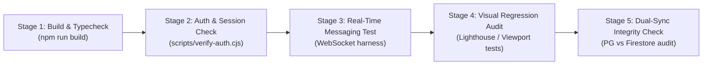

# BOND — REGRESSION TEST & VERIFICATION STRATEGY
**Document:** REGRESSION_TEST_STRATEGY.md  
**Version:** 3.0.0 (Phase 3A Quality Assurance Protocol)  
**Target Platform:** BOND (A Connected Global Digital Ecosystem)  
**Status:** Complete Regression Specification  

---

## 1. Regression Prevention Objectives

To uphold the **Master Project Development Directive** and protect the existing working Aeirmist UI/UX and backend functionality:
- **Zero Broken Flows:** No change to any module may break existing login, messaging, post creation, profile editing, or admin telemetry.
- **Automated Verification:** Every proposed change must pass a multi-stage automated test harness before promotion to production.

---

## 2. Test Execution Matrix

### Test Suite Specifications:
1. **Type Safety & Build Verification:**
   - Command: `npm run build`
   - Gate: Must complete with 0 TypeScript and 0 Rollup/Vite bundling errors.
2. **Authentication & Session Longevity:**
   - Script: `scripts/verify-auth.cjs`
   - Checks: Password login, JWT issuance, token refresh, and session revocation.
3. **Messaging & Group Chat Integrity:**
   - Checks: Group creation latency < 150ms, accurate group name in header, instant delivery to all member rooms.
4. **Visual & UI Layout Protection:**
   - Checks: Mobile responsiveness (<768px), desktop navbar, dark mode contrast, zero broken icons or placeholder text.
5. **Database DDL Additive Audit:**
   - Checks: SQL migrations scanned for forbidden keywords (`DROP`, `TRUNCATE`, `ALTER TABLE ... DROP`).
