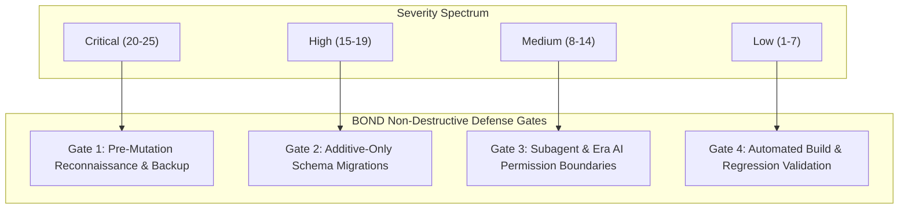

# BOND — RISK REGISTER & MITIGATION MATRIX
**Version:** 1.0.0  
**Target Platform:** BOND (A Connected Global Digital Ecosystem)  
**Baseline Codebase:** Aeirmist 2.0 Core  
**Date:** November 2026  
**Auditor:** Antigravity AI Engineering Suite  

---

## 1. Risk Assessment Matrix & Methodology

Risks are quantified based on **Severity (1-5)** and **Likelihood (1-5)** to derive a **Risk Priority Score (1-25)**:
- **Critical (20 - 25):** Immediate system danger; requires architectural gates before proceeding.
- **High (15 - 19):** High impact; requires defensive fallbacks and comprehensive monitoring.
- **Medium (8 - 14):** Manageable operational risk; addressed via standard engineering protocols.
- **Low (1 - 7):** Minor technical debt or edge case.

---

## 2. Risk Register Catalog

| ID | Risk Category | Description | Severity | Likelihood | Score | Mitigation Protocol |
| :--- | :--- | :--- | :---: | :---: | :---: | :--- |
| **R-01** | **Data Integrity** | Accidental data reset or column truncation during PostgreSQL migration. | 5 | 1 | **5 (Low)** | Strictly enforce **Additive Migrations Only**. Disallow `DROP TABLE`, `DROP COLUMN`, or `TRUNCATE` in production scripts. Require checkpoint verification before DDL execution. |
| **R-02** | **Dual Sync Drift** | Desynchronization between PostgreSQL records and Firestore mirrors. | 4 | 2 | **8 (Med)** | PostgreSQL is designated as the sole authoritative System of Record (SoR). Background reconciliation worker periodically detects and repairs discrepancies. |
| **R-03** | **Era AI Boundary** | Era AI taking automated high-stakes actions without user approval. | 5 | 1 | **5 (Low)** | Enforce strict **Human-in-the-Loop Guardrails**. Any mutation to user profiles, permissions, payments, or records requires explicit user UI confirmation. Exclude Era AI from user lists. |
| **R-04** | **Real-Time Scaling** | High WebSocket concurrency overwhelming single-node Socket.IO. | 4 | 3 | **12 (Med)** | Deploy `socket.io-redis-adapter` for multi-node pub/sub clustering. Route read-heavy events through Cloudflare Edge Functions. |
| **R-05** | **UI/UX Regression** | Unintended disruption to existing layout, styling, or buttons during BOND feature additions. | 4 | 2 | **8 (Med)** | Adhere to Section 2 Non-Destructive Rules: Never redesign existing layouts without approval. Isolate new feature code in dedicated modules. |
| **R-06** | **Credential Exposure**| Secret keys or tokens committed to source control or exposed in edge builds. | 5 | 1 | **5 (Low)** | Store all sensitive credentials exclusively in environment variables (`.env`, Cloudflare Secrets). Scan git commits with automated pre-commit hooks. |
| **R-07** | **Messaging Latency** | Group creation or message sending hanging due to remote network timeouts. | 3 | 2 | **6 (Low)** | Wrap all remote calls in `Promise.race` with 3.5s fallbacks. Render optimistic local updates immediately with background sync. |

---

## 3. Rollback & Disaster Recovery Procedures

1. **Database Rollback:**
   - All migrations maintain downward-compatible DDL.
   - Point-In-Time Recovery (PITR) enabled on production PostgreSQL with 30-day retention.
2. **Edge & Frontend Rollback:**
   - Cloudflare Pages allows instantaneous 1-click rollback to any prior deployment hash (`https://aeirmist-f0m.pages.dev`).
3. **Emergency Circuit Breaker:**
   - In the event of an unhandled backend error, frontend gracefully degrades to local offline cache mode with user toast alerts.
