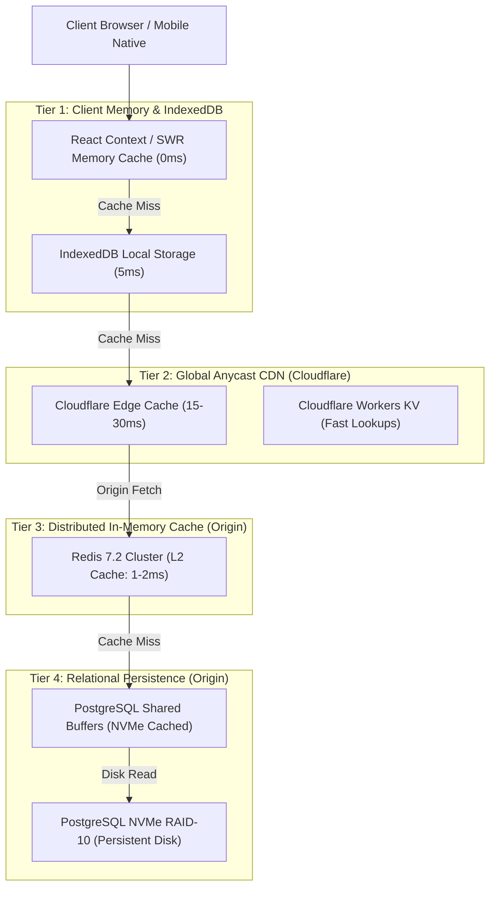

# BOND — PERFORMANCE, SCALABILITY & CAPACITY PLANNING
**Document:** SCALABILITY_PLAN.md  
**Version:** 2.0.0 (Phase 2 Architectural Baseline)  
**Target Platform:** BOND (A Connected Global Digital Ecosystem)  
**Objective:** Define measurable performance targets, multi-tier caching, queue architectures, and empirical load testing methodologies  
**Status:** Architecture Design (Planning Only — Zero Source Code Mutations)  

---

## 1. Measurable Performance Targets (SLAs & SLOs)

BOND establishes explicit, empirically testable Service Level Objectives (SLOs) rather than theoretical claims:

| Metric | Target (p95) | Target (p99) | Measurement Tool / Method |
| :--- | :--- | :--- | :--- |
| **Edge Cache Hits (Static/Media)** | < 25 ms | < 50 ms | Cloudflare Analytics / Real User Monitoring (RUM) |
| **API Read Endpoints (e.g. `/users`, `/feed`)** | < 45 ms | < 120 ms | OpenTelemetry Tracing / Synthetic k6 Probes |
| **API Write Endpoints (e.g. Post Creation)** | < 90 ms | < 250 ms | PostgreSQL Transaction Logs / Prometheus |
| **Real-Time Message Delivery (End-to-End)** | < 80 ms | < 180 ms | Client-side roundtrip timestamp telemetry |
| **Database Query Budget (Single Query)** | < 15 ms | < 50 ms | `pg_stat_statements` / PgBouncer monitor |
| **Web Frontend Largest Contentful Paint (LCP)**| < 1.2 s | < 2.0 s | Chrome UX Report (CrUX) / Lighthouse CI |
| **First Input Delay / INP** | < 50 ms | < 100 ms | Web Vitals JS telemetry |

---

## 2. Multi-Tier Caching Architecture



### 2.1 Caching Policies by Data Entity
- **Public Media & Static Assets:** `Cache-Control: public, max-age=31536000, immutable` (Edge Cached 365 Days).
- **User Profile Data:** Redis cached with a 300s TTL. Evicted immediately via event-driven invalidation upon `PATCH /api/v1/profiles/me`.
- **Home Feed Timelines:** Materialized feed lists stored in Redis Sorted Sets (`ZADD feed:<userId> <timestamp> <postId>`) capped at 500 items per active user.
- **Spaces & Chat Settings:** Redis cached with 600s TTL; updated via WebSocket broadcast.

---

## 3. Database Query Optimization & Partitioning

### 3.1 Strict Indexing & Optimization Rules
1. **Zero Unindexed Foreign Keys:** All foreign keys must possess explicit BTREE indexes to prevent full-table sequential scans during joins and cascade evaluations.
2. **Deterministic Pagination:** Prohibit `OFFSET / LIMIT` pagination for large tables (`posts`, `messages`, `notifications`). Enforce **Keyset / Cursor Pagination** utilizing composite indexes:
   ```sql
   -- Efficient Keyset Query (<10ms across 10M rows)
   SELECT * FROM posts
   WHERE (created_at, id) < (:cursor_created_at, :cursor_id)
   ORDER BY created_at DESC, id DESC
   LIMIT 20;
   ```
3. **Table Partitioning Strategy:**
   - `messages`: Partitioned by Range on `created_at` (Monthly partitions).
   - `audit_logs`: Partitioned by Range on `created_at` (Monthly partitions).
   - Historical partitions older than 12 months detached and archived to compressed cold storage in Cloudflare R2.

---

## 4. Asynchronous Queue Processing (BullMQ + Redis)

Heavy, compute-intensive, or external network operations are decoupled from user request threads into **BullMQ asynchronous queues**:

```mermaid
graph LR
    REQ["HTTP Request"] --> API["Fast Core API Handler"]
    API -->|1. Instant DB Commit| PG[("PostgreSQL")]
    API -->|2. Enqueue Job (<2ms)| BULL[("BullMQ Queue (Redis)")]
    API -->|3. Instant HTTP 201| RESP["HTTP 201 OK to Client"]

    BULL --> W1["Worker: Media Compression (WebP / AVIF)"]
    BULL --> W2["Worker: Push Notifications (WebPush/FCM/APNs)"]
    BULL --> W3["Worker: Semantic Embeddings (pgvector)"]
    BULL --> W4["Worker: Outbound Webhook Delivery"]
    BULL --> W5["Worker: Email Dispatch"]
```

### Queue Configurations:
- **`media-transcode-queue`:** Concurrency 8, retry 3 times with exponential backoff.
- **`notifications-queue`:** Concurrency 20, batched dispatch (up to 100 alerts / job).
- **`webhooks-queue`:** Concurrency 10, dead-letter queue enabled for unresolvable endpoints.
- **`ai-embedding-queue`:** Concurrency 4, throttled to prevent LLM provider rate limit saturation.

---

## 5. Real-Time Scaling & Horizontal Sockets

- **Clustered Socket.IO:** Clustered across multiple Node.js processes using `cluster` module and PM2, with inter-process communication mediated by the **`@socket.io/redis-adapter`**.
- **Connection Capacity per Node:** Tuned Linux kernel parameters (`sysctl -w net.core.somaxconn=65535`, `sysctl -w fs.file-max=2097152`, `nofile: 65536`) allowing 50,000 concurrent active WebSocket connections per 32-core server.
- **Heartbeat & Reconnection:** 25-second ping interval, 10-second timeout. Clients utilize randomized exponential backoff with jitter on reconnects to avoid thundering herd storms on server restart.

---

## 6. Traffic Milestones & Scaling Roadmap

| Tier | Target DAU | Concurrent Sockets | Primary Bottleneck | Architectural Solution |
| :--- | :--- | :--- | :--- | :--- |
| **Milestone 1** | **10,000** | ~2,500 | None (Single Origin + Edge) | Single 32-Core Host + Cloudflare CDN handles load at <15% CPU. |
| **Milestone 2** | **100,000** | ~25,000 | PostgreSQL Read IOPS | Enable Read Replica for search and analytics; PgBouncer connection pooling. |
| **Milestone 3** | **1,000,000** | ~200,000 | WebSocket Concurrency & Feed Fanout | Horizontal socket cluster (3 dedicated nodes); Materialized Redis feeds. |
| **Milestone 4** | **10,000,000**| ~1,500,000 | Database Write Throughput | Database sharding / Citus clustering by `organization_id` & `user_id` hash. |

---

## 7. Load Testing & Empirical Verification Methodology

### 7.1 Automated k6 Test Scenarios
All performance benchmarks are verified through reproducible **k6 load test scripts**:
1. **Baseline Smoke Test:** 50 virtual users (VUs) verifying 200 OK responses across core endpoints.
2. **Stress & Concurrency Test:** Ramp from 100 to 5,000 VUs over 10 minutes testing:
   - User login and JWT validation.
   - Home feed pagination.
   - Real-time chat message dispatch and Redis fanout.
   - Acceptance Criteria: Error rate < 0.1%, p95 response time < 150ms.
3. **Spike Test:** Instant jump from 200 to 2,000 VUs in 15 seconds to test Cloudflare edge caching, PgBouncer queuing, and CPU auto-recovery without dropped connections.
