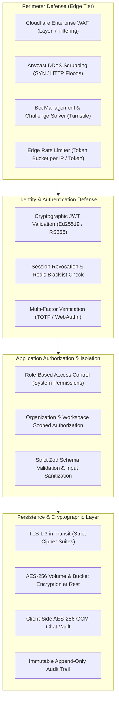
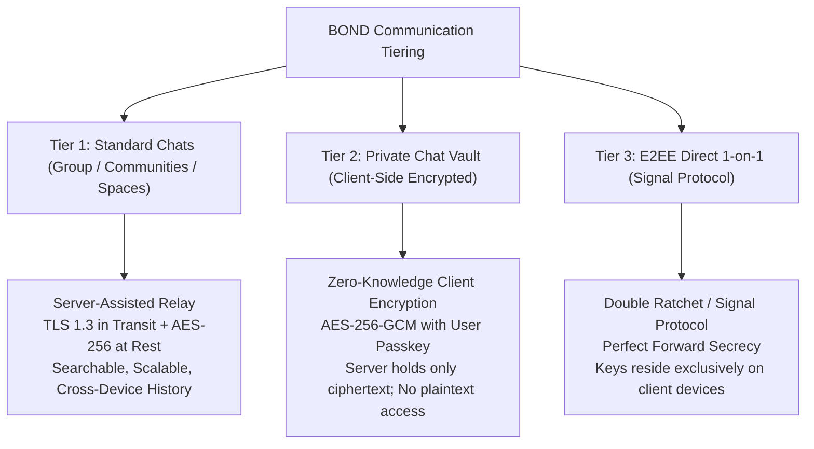

# BOND — SECURITY ARCHITECTURE & THREAT MODEL
**Document:** SECURITY_ARCHITECTURE.md  
**Version:** 2.0.0 (Phase 2 Architectural Baseline)  
**Target Platform:** BOND (A Connected Global Digital Ecosystem)  
**Security Standard:** Zero-Trust Edge, Defense-in-Depth, OWASP Top 10 Compliance  
**Status:** Architecture Design (Planning Only — Zero Source Code Mutations)  

---

## 1. Threat Modeling & Security Principles

BOND adopts a **Zero-Trust Architecture** where every boundary request—whether from external clients, edge workers, or internal background jobs—must be explicitly authenticated, strictly authorized, and cryptographically verified.

---

## 2. Authentication & Credential Security

### 2.1 Password Security & Hashing
- **Algorithm:** Argon2id (`memoryCost: 65536` (64MB), `timeCost: 3`, `parallelism: 4`) exceeding OWASP recommendations.
- **Salting:** Unique cryptographically secure 16-byte random salt generated per user via `crypto.randomBytes(16)`.
- **Policy:** Minimum 10 characters with entropy checks rejecting common breached passwords.

### 2.2 Token Lifecycle & Session Rotation
- **Dual-Token Architecture:**
  1. **Access Token:** Short-lived JWT (15-minute TTL) signed using RS256 private key. Contains `userId`, `role`, and `sessionId`. Verified at the edge without database lookups.
  2. **Refresh Token:** Cryptographically random 256-bit token stored in the `refresh_tokens` table as a SHA-256 hash. Stored in an `HttpOnly`, `Secure`, `SameSite=Lax` cookie.
- **Rotation on Refresh:** Every refresh request issues a new refresh token and invalidates the previous one. If a previously consumed refresh token is presented, the system treats it as token theft, immediately revoking all active sessions for that user.

### 2.3 Passkeys & WebAuthn (FIDO2)
- Hardware-backed biometric authentication (Touch ID, Face ID, YubiKey) supported via WebAuthn API.
- Replaces SMS OTPs with phishing-resistant public-key cryptography.

---

## 3. Authorization Architecture (RBAC & ABAC)

### 3.1 Platform Roles (RBAC)
- `superadmin`: Absolute administrative access, system telemetry, flag overrides, database operations.
- `admin`: User suspension/banning, report adjudication, verified badge evaluation.
- `staff`: Content moderation, support ticket responses.
- `member`: Standard authenticated individual identity.
- `guest`: Read-only public access.

### 3.2 Workspace & Organizational Isolation (ABAC)
- Multi-tenancy is strictly enforced at the data layer:
  - Projects, tasks, team channels, and commercial records must belong to an `organization_id` or `space_id`.
  - Queries enforce workspace tenancy predicates: `WHERE organization_id = :currentOrgId`.
  - Cross-organization data leakage is prevented via parameterized middleware validation before database execution.

---

## 4. Encryption Strategy & Messaging Mode Evaluation

### 4.1 Factual Evaluation of Messaging Encryption Modes

In strict compliance with the directive (*"Evaluate whether end-to-end encryption is appropriate for different messaging modes. Do not claim encryption guarantees without a defined and tested implementation."*), BOND categorizes messaging into three explicit security tiers:

#### Tier 1: Standard Group & Community Spaces
- **Architecture:** Server-assisted messaging via TLS 1.3 in transit and AES-256 at rest in PostgreSQL.
- **Justification:** Multi-device synchronization, offline member fan-out, persistent searchable history, and media transcoding across 1,000+ members cannot operate under client-bound E2EE without severe performance degradation and key-distribution failure modes.
- **Guarantee Claimed:** Encrypted in transit (TLS 1.3) and encrypted at rest (AES-256 volume encryption); server participates in routing.

#### Tier 2: Private Chat Vault
- **Architecture:** Zero-knowledge client-side encryption. The user establishes a Vault Master Passkey (never sent to the server).
- **Implementation:** Keys derived via PBKDF2 (100,000 iterations, SHA-256) on the client. Messages, files, and notes are encrypted using AES-256-GCM before transmission.
- **Guarantee Claimed:** Zero-knowledge storage. The server stores ciphertext and initialization vectors (IVs) only. If the server database is compromised, Vault contents remain unreadable without the user's master passkey.

#### Tier 3: 1-on-1 Direct Messaging (Signal Double Ratchet)
- **Architecture:** End-to-end encryption using the Signal Protocol (X3DH key agreement + Double Ratchet algorithm).
- **Implementation Constraints:** Requires verified device pre-keys stored on the server.
- **Operational Reality:** True E2EE restricts message synchronization to devices possessing the private ratchet state. Multi-device web browsers clearing IndexedDB will lose historical messages unless encrypted cloud backups are provisioned.
- **Claim Policy:** E2EE is claimed exclusively for direct chats where both participants have verified active key pairs and the conversation displays the explicit E2EE lock verification shield.

---

## 5. Storage Security & Media Access Control

### 5.1 Cloudflare R2 Presigned URLs
- Direct client uploads bypass origin application servers, eliminating bandwidth bottlenecks and buffer exhaustion vulnerabilities.
- Uploads require a presigned PUT URL issued by the API with:
  - 15-minute expiration timestamp.
  - Strict `Content-Type` matching.
  - Content-Length constraints enforced at the edge.

### 5.2 Private File Download Protection
- Non-public assets (verification documents, deal room pitch decks, Vault items) are served via signed GET URLs with 60-second validity or streamed through an authenticated origin proxy validating authorization before byte dispatch.

---

## 6. Rate Limiting, DDoS & Abuse Prevention

### 6.1 Multi-Layer Rate Limiting
1. **Cloudflare Edge WAF:** Global volumetric rate limiting based on client IP and ASN.
2. **Origin Redis Sliding Window:** Fine-grained rate limits per user token:
   - Auth endpoints (`/api/v1/auth/*`): 10 requests / minute.
   - Message sending: 60 messages / minute.
   - Post creation: 10 posts / minute.
   - Public search: 30 requests / minute.

### 6.2 Cloudflare Turnstile & Bot Mitigation
- High-risk endpoints (registration, password reset, account recovery) mandate a Cloudflare Turnstile CAPTCHA response token verified server-side.

---

## 7. Audit Logging & Account Recovery

### 7.1 Immutable Audit Logging
- Every administrative action, role modification, authentication event, and financial transaction writes an immutable record to the `audit_logs` table.
- Log entries capture: `actor_id`, `action`, `target_type`, `target_id`, `details`, `ip_address`, `user_agent`, `created_at`.
- Triggers disallow `UPDATE` or `DELETE` operations on `audit_logs` at the database engine level.

### 7.2 Secure Account Recovery
- Password reset tokens generated via `crypto.randomBytes(32)` with a 30-minute expiration.
- Stored as SHA-256 hashes in the database.
- Executing a password reset immediately revokes all active login sessions and refresh tokens across all devices.
