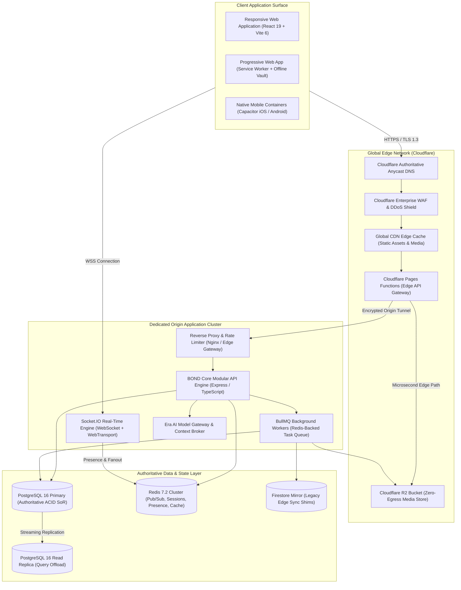

# BOND — SYSTEM ARCHITECTURE
**Document:** SYSTEM_ARCHITECTURE.md  
**Version:** 2.0.0 (Phase 2 Architectural Baseline)  
**Target Platform:** BOND (A Connected Global Digital Ecosystem)  
**Classification:** Enterprise Engineering Architecture Specification  
**Status:** Architecture Design (Planning Only — Zero Source Code Mutations)  

---

## 1. Executive Summary & Design Principles

BOND is architected as a **Connected Global Digital Ecosystem** unifying personal identity, professional collaboration, social networking, capital formation, career mobility, knowledge sharing, developer extensibility, and contextual artificial intelligence into a resilient, high-throughput platform.

### 1.1 Non-Destructive Architectural Invariants
1. **Preserve Tested Foundations:** Built upon the audited, production-verified Aeirmist 2.0 baseline (React 19, Vite 6, Tailwind CSS v4, Express.js, Drizzle ORM, PostgreSQL, Redis, Cloudflare Edge, Capacitor).
2. **Modular Monolith over Microservice Sprawl:** To prevent operational fragmentation, distributed failure cascades, and high network latency, BOND organizes capabilities into distinct, domain-bounded services running within an orchestrated, modular runtime.
3. **One Person, One Main Profile:** Every natural person possesses a singular verified human identity anchoring all personal credentials, reputation, and security. Workspaces, teams, businesses, and creator channels exist as separate organizational entities owned or managed by that primary identity.
4. **Edge-Accelerated, Origin-Authoritative:** Cloudflare Edge functions handle instantaneous routing, static delivery, edge caching, and security enforcement, while a dedicated PostgreSQL cluster acts as the singular ACID-compliant System of Record (SoR).

---

## 2. End-to-End System Topology

---

## 3. Core Domain Services (21 Architectural Modules)

Each module is designed with strict boundaries, explicit dependency contracts, decoupled database models, and clear scaling characteristics.

```mermaid
graph LR
    subgraph CoreIdentityServices ["Identity & Security"]
        S01["1. Auth Service"]
        S02["2. Authorization (RBAC/ABAC)"]
        S03["3. User Profile Service"]
    end

    subgraph CommunicationCollaboration ["Social & Communication"]
        S04["4. Social Feed Service"]
        S05["5. Discovery & Search"]
        S06["6. Team & Community Service"]
        S07["7. Messaging & WebRTC Service"]
        S08["8. Notification Service"]
        S09["9. Media Processing Service"]
    end

    subgraph BusinessEcosystem ["Ecosystem & Commerce"]
        S10["10. Project Management Service"]
        S11["11. Hiring & Talent Service"]
        S12["12. Investor & Sponsor Service"]
        S13["13. Payment & Billing Service"]
        S14["14. Learning & Knowledge"]
        S15["15. Events & Ticketing"]
    end

    subgraph PlatformGovernance ["Intelligence & Platform"]
        S16["16. Developer Platform"]
        S17["17. Era AI Gateway"]
        S18["18. Administration & Audit"]
    end

    CoreIdentityServices --> CommunicationCollaboration
    CommunicationCollaboration --> BusinessEcosystem
    BusinessEcosystem --> PlatformGovernance
```

---

### Module 1: Authentication Service
- **Responsibilities:** Identity verification, password hashing (Argon2id), OAuth2 / OpenID Connect federation (Google, Apple, GitHub), multi-factor authentication (TOTP, WebAuthn Passkeys), session issuance and rotation.
- **Dependencies:** Database layer (`users`, `login_sessions`, `refresh_tokens`), Redis token blacklist.
- **APIs:** `/api/v1/auth/register`, `/api/v1/auth/login`, `/api/v1/auth/refresh`, `/api/v1/auth/logout`, `/api/v1/auth/mfa/*`, `/api/v1/auth/passkeys/*`.
- **Database Requirements:** `users`, `login_sessions`, `refresh_tokens` tables with strict unique indexes and foreign key cascading.
- **Security:** Brute-force rate limiting (Redis sliding window), constant-time credential comparison, secure HttpOnly SameSite=Lax cookie storage.
- **Scaling Requirements:** Stateless JWT verification at Edge (<2ms); token generation and refresh cached in Redis.
- **Failure Handling:** Fallback to session store validation if Redis cluster is temporarily partitioned.

### Module 2: Authorization Service (RBAC & ABAC)
- **Responsibilities:** Enforcement of platform-level roles (Superadmin, Admin, Staff, Verified Member, Member, Guest) and organization-level roles (Owner, Admin, Moderator, Contributor, Viewer).
- **Dependencies:** Authentication Service, Database (`profiles`, `conversation_members`, `project_members`).
- **APIs:** Internal middleware guards (`requirePermission`, `requireOrgRole`, `requireResourceOwner`).
- **Database Requirements:** `roles`, `permissions`, `role_permissions`, and membership association tables.
- **Security:** Principle of least privilege; deny-by-default execution policy; audit logging of elevation attempts.
- **Scaling Requirements:** In-memory bitmask permission caching per active session in Redis with 180s TTL.
- **Failure Handling:** Fails closed (HTTP 403 Forbidden) upon authorization resolution errors.

### Module 3: User Profile Service
- **Responsibilities:** Personal identity management, biography, skills catalog, work experiences, education, social links, verification badge status, avatar and banner management.
- **Dependencies:** Authentication Service, Media Processing Service.
- **APIs:** `/api/v1/profiles/me`, `/api/v1/profiles/:username`, `/api/v1/profiles/experiences`, `/api/v1/profiles/skills`.
- **Database Requirements:** `profiles`, `user_skills`, `user_experiences`, `verification_records`.
- **Security:** Private profile field filtering; sanitization of rich text; unicity constraints on usernames (`@username`).
- **Scaling Requirements:** High-frequency read offload via Cloudflare Edge Cache and Redis L2 Cache with automatic purge on mutation.
- **Failure Handling:** Read-replica routing if primary database is experiencing write contention.

### Module 4: Social Feed Service
- **Responsibilities:** Publication, ingestion, curation, and delivery of user posts, multi-image albums, video reels, polls, reposts, comments, and bookmarking.
- **Dependencies:** User Profile Service, Media Processing Service, Notification Service.
- **APIs:** `/api/v1/posts`, `/api/v1/posts/:id`, `/api/v1/posts/:id/comments`, `/api/v1/posts/:id/like`, `/api/v1/posts/:id/bookmark`, `/api/v1/feed/home`.
- **Database Requirements:** `posts`, `post_likes`, `post_bookmarks`, `comments`, `comment_likes`, `poll_votes`.
- **Security:** Author validation for updates/deletions; server-side sanitization of markdown and embeds; automated spam scoring.
- **Scaling Requirements:** Fan-out on read with cursor-based pagination (`created_at` + `id`); hot posts cached in Redis sorted sets.
- **Failure Handling:** Graceful degradation to chronologically sorted feed if recommendation scoring workers encounter backpressure.

### Module 5: Discovery & Search Service
- **Responsibilities:** Global indexing and search across Users, Posts, Projects, Communities, Jobs, and Events; trending hashtags and discovery algorithms.
- **Dependencies:** Database read replicas, PostgreSQL Full-Text Search (`tsvector` + GIN indexes).
- **APIs:** `/api/v1/search`, `/api/v1/discover/trending`, `/api/v1/discover/people`, `/api/v1/discover/projects`.
- **Database Requirements:** `tsvector` generated columns on `profiles`, `posts`, `projects`, `teams`, `jobs`.
- **Security:** Excludes blocked users and private entities from search results; query rate limiting.
- **Scaling Requirements:** Edge caching for common trending queries (60s TTL); debounced query execution on clients.
- **Failure Handling:** Fallback to exact-match ILIKE queries if GIN index rebuilds are active.

### Module 6: Team & Community Service (Spaces)
- **Responsibilities:** Management of multi-user collaborative entities:
  - **Groups:** Private personal circles.
  - **Communities:** Open public discussion hubs with thematic channels.
  - **Teams:** Dedicated productivity and project workspaces.
- **Dependencies:** User Profile Service, Notification Service, Authorization Service.
- **APIs:** `/api/v1/spaces`, `/api/v1/spaces/:id`, `/api/v1/spaces/:id/members`, `/api/v1/spaces/:id/roles`.
- **Database Requirements:** `teams`, `communities`, `conversation_members`, `space_settings`.
- **Security:** Strict separation between personal identity and workspace role; owner transfer protocol; member invite validation.
- **Scaling Requirements:** Multi-tenant workspace partitioning; space member caches in Redis.
- **Failure Handling:** Local state synchronization with optimistic client recovery.

### Module 7: Messaging & WebRTC Communication Service
- **Responsibilities:** Real-time 1-on-1 direct messaging, group chat, voice notes with interactive waveforms, message reactions, editing, vanishing mode, private Vault encryption, WebRTC 1-on-1 and mesh audio/video calling.
- **Dependencies:** Redis pub/sub adapter, Socket.IO, PostgreSQL, WebRTC STUN/TURN infrastructure.
- **APIs:** `/api/v1/chat/conversations`, `/api/v1/chat/messages`, `/api/v1/calls/signal`, WebSocket events (`send_message`, `typing`, `message_seen`, `call_offer`, `call_answer`).
- **Database Requirements:** `conversations`, `conversation_members`, `messages`, `message_reactions`, `calls`, `vault_items`.
- **Security:** End-to-end Signal double ratchet encryption evaluation; TLS 1.3 in transit; AES-256 for Vault items; strict rate limiting (60 msgs/min).
- **Scaling Requirements:** Redis-backed cluster fan-out via `socket.io-redis-adapter`; sub-80ms message delivery SLA.
- **Failure Handling:** Offline message queueing with automatic sync upon reconnect; message delivery retry receipts.

### Module 8: Notification Service
- **Responsibilities:** Aggregation, deduplication, and multi-channel dispatch of user notifications (In-App, Push via WebPush/APNs/FCM, Email transactional alerts).
- **Dependencies:** Redis Queue (BullMQ), Database (`notifications`, `push_subscriptions`).
- **APIs:** `/api/v1/notifications`, `/api/v1/notifications/read`, `/api/v1/notifications/subscriptions`.
- **Database Requirements:** `notifications`, `push_subscriptions` with indexing on `(recipient_id, is_read, created_at)`.
- **Security:** Recipient verification; rate limiting to prevent notification flooding; user privacy preferences.
- **Scaling Requirements:** Asynchronous job processing; batched dispatch for high-frequency events (e.g. viral post likes).
- **Failure Handling:** Dead-letter queues for failed external push delivery with exponential backoff.

### Module 9: Media Processing Service
- **Responsibilities:** Upload presigning, chunked resumable uploads, image optimization (WebP/AVIF generation, thumbnail extraction), audio transcoding (Opus/AAC), video stream packaging.
- **Dependencies:** Cloudflare R2, Sharp / FFmpeg worker pool.
- **APIs:** `/api/v1/media/upload-url`, `/api/v1/media/confirm`, `/api/v1/media/:id`.
- **Database Requirements:** `media_assets` with hash deduplication, mime types, byte size, and owner references.
- **Security:** Presigned URLs with 15-minute TTL; magic byte MIME validation; file size limits (5MB images, 25MB audio, 100MB video); virus/malware scanning hooks.
- **Scaling Requirements:** Zero egress cost with Cloudflare R2; client-side image compression prior to transfer.
- **Failure Handling:** Orphaned upload cleanup worker purging unconfirmed presigned assets after 24 hours.

### Module 10: Project Management Service
- **Responsibilities:** Creation and tracking of collaborative initiatives, tasks, Kanban boards, roadmaps, milestones, deliverables, and team task assignments.
- **Dependencies:** Team Service, User Profile Service, Notification Service.
- **APIs:** `/api/v1/projects`, `/api/v1/projects/:id/tasks`, `/api/v1/projects/:id/milestones`.
- **Database Requirements:** `projects`, `project_members`, `tasks`, `milestones`.
- **Security:** Workspace-scoped access control; granular task edit permissions; activity audit trails.
- **Scaling Requirements:** Project boards cached in Redis with WebSocket delta updates.
- **Failure Handling:** Offline task caching in IndexedDB for mobile/PWA users.

### Module 11: Hiring & Talent Service
- **Responsibilities:** Job postings, freelancing gigs, talent discovery, applicant tracking, resume submissions, contract milestones, and recruitment workflows.
- **Dependencies:** User Profile Service, Organization Service, Notification Service.
- **APIs:** `/api/v1/jobs`, `/api/v1/jobs/:id/apply`, `/api/v1/talent/search`, `/api/v1/hiring/applications`.
- **Database Requirements:** `jobs`, `job_applications`, `talent_profiles`, `skill_assessments`.
- **Security:** PII masking for applicants prior to screening; employer verification requirements.
- **Scaling Requirements:** Filterable job search with GIN index on locations, skill requirements, and compensation bands.
- **Failure Handling:** Asynchronous notification queue ensures applicant alerts survive peak loads.

### Module 12: Investor & Sponsor Service
- **Responsibilities:** Ecosystem capital formation, startup funding rounds, sponsor directories, pitch deck reviews, verified investor accreditation, and deal-flow tracking.
- **Dependencies:** Project Service, Organization Service, Verification Service, Audit Service.
- **APIs:** `/api/v1/capital/opportunities`, `/api/v1/capital/pitches`, `/api/v1/capital/investors`.
- **Database Requirements:** `investor_profiles`, `funding_opportunities`, `funding_requests`, `deal_rooms`.
- **Security:** Strict NDAs and confidentiality flags; verified accreditation gating; encrypted deal room documents.
- **Scaling Requirements:** Low-frequency, high-value relational transactions; rigorous audit logging.
- **Failure Handling:** Atomic multi-table transactions for funding state transitions.

### Module 13: Payment & Billing Service
- **Responsibilities:** Unified billing engine, subscription management (Individual Premium, Pro, Teams, Enterprise), marketplace item transactions, ticketing payouts, and invoice generation.
- **Dependencies:** Stripe API, Regional Gateways (bKash, Nagad, SEPA, UPI), Database (`subscriptions`, `transactions`).
- **APIs:** `/api/v1/billing/checkout`, `/api/v1/billing/portal`, `/api/v1/billing/webhooks`, `/api/v1/billing/invoices`.
- **Database Requirements:** `subscriptions`, `transactions`, `marketplace_orders`, `payment_methods`.
- **Security:** PCI-DSS Level 1 compliance via tokenization; mandatory `Idempotency-Key` headers; HMAC-SHA256 signature verification on webhooks.
- **Scaling Requirements:** Asynchronous webhook processing; zero synchronous external calls in critical user paths.
- **Failure Handling:** Automatic retry with exponential backoff for failed webhook events; reconciliation cron jobs.

### Module 14: Learning & Knowledge Service
- **Responsibilities:** Collaborative knowledge bases, educational courses, technical documentation, tutorials, certifications, and research publication.
- **Dependencies:** User Profile Service, Media Processing Service, Search Service.
- **APIs:** `/api/v1/knowledge/articles`, `/api/v1/courses`, `/api/v1/courses/:id/enroll`.
- **Database Requirements:** `courses`, `course_modules`, `enrollments`, `knowledge_resources`.
- **Security:** Content licensing controls; digital rights management for premium course materials.
- **Scaling Requirements:** High cacheability via Cloudflare CDN (Edge TTL 3600s); read-optimized replica queries.
- **Failure Handling:** Static markdown fallback rendering on client.

### Module 15: Events & Ticketing Service
- **Responsibilities:** Virtual and hybrid event hosting, conference agendas, hackathons, RSVPs, ticket tier configuration, QR code check-in, and attendee networking.
- **Dependencies:** Payment Service, Team Service, Notification Service.
- **APIs:** `/api/v1/events`, `/api/v1/events/:id/tickets`, `/api/v1/events/:id/checkin`.
- **Database Requirements:** `events`, `event_tickets`, `ticket_purchases`, `event_speakers`.
- **Security:** Cryptographically signed ticket barcodes/QR codes (HMAC-SHA256); double-spend prevention on tickets.
- **Scaling Requirements:** High-concurrency ticket release handling using Redis atomics (`DECRBY`) to prevent overselling.
- **Failure Handling:** Queue-based checkout reservation holds with 10-minute expiration.

### Module 16: Developer Platform Service
- **Responsibilities:** Open API ecosystem, third-party developer applications, OAuth2 authorization grants, API key generation, rate limiting, and outbound webhook delivery.
- **Dependencies:** Authentication Service, API Gateway, Audit Service.
- **APIs:** `/api/v1/developer/apps`, `/api/v1/developer/credentials`, `/api/v1/developer/webhooks`.
- **Database Requirements:** `developer_apps`, `api_credentials`, `webhook_subscriptions`, `webhook_deliveries`.
- **Security:** Scoped OAuth scopes (`read:profile`, `write:feed`, `read:messages`); SHA-256 hashed API keys; webhook delivery signing.
- **Scaling Requirements:** Distributed token-bucket rate limiter enforced at Cloudflare Edge before origin hit.
- **Failure Handling:** Exponential backoff and retry policy (1m, 5m, 1h, 6h, 24h) for failed webhook deliveries.

### Module 17: Era AI Integration Gateway
- **Responsibilities:** Provider-independent intelligence orchestration, context window management, Retrieval-Augmented Generation (RAG) across user notes and public knowledge, guarded tool execution, and usage telemetry.
- **Dependencies:** Core API, PostgreSQL pgvector / semantic embeddings, LLM APIs (Gemini, Claude, OpenAI, Local models).
- **APIs:** `/api/v1/ai/chat`, `/api/v1/ai/summarize`, `/api/v1/ai/draft`, `/api/v1/ai/tools/execute`.
- **Database Requirements:** `ai_conversations`, `ai_messages`, `ai_usage_quotas`, `semantic_embeddings`.
- **Security:** Strict **Human-in-the-Loop Guardrail**: AI is permanently prohibited from mutating user state, sending money, or changing passwords without explicit interactive UI confirmation. Permission-aware data extraction.
- **Scaling Requirements:** Streaming responses via Server-Sent Events (SSE) / WebSockets; asynchronous embedding pipelines.
- **Failure Handling:** Multi-model fallback: if Primary model times out, fallback to Secondary tier transparently.

### Module 18: Administration & Moderation Service
- **Responsibilities:** Enterprise Control Center, 5s live telemetry, user status moderation (Active, Suspended, Banned), content report review, verification badge evaluation, audit log inspection, feature flag toggling.
- **Dependencies:** All Services, Database (`audit_logs`, `content_reports`, `support_tickets`).
- **APIs:** Clean direct URLs (`/admin`, `/admin/users`, `/admin/reports`, `/admin/appeals`, `/admin/tickets`, `/admin/verification`, `/admin/marketplace`, `/admin/security`, `/admin/roles`, `/admin/flags`, `/admin/logs`, `/admin/system`).
- **Database Requirements:** `audit_logs`, `content_reports`, `system_flags`, `support_tickets`, `user_appeals`.
- **Security:** Strict Superadmin / Admin RBAC; multi-factor authentication enforcement; immutable append-only audit trail.
- **Scaling Requirements:** Zero-latency cached reads (<15ms) on user directories; paginated audit queries.
- **Failure Handling:** Direct fallback to read-replica database queries.

---

## 4. Communication & Protocol Architecture

| Channel | Protocol | Use Case | Latency Target |
| :--- | :--- | :--- | :--- |
| **Client to Edge** | HTTPS / HTTP/3 | REST APIs, static files, upload presigning | <30ms |
| **Real-Time Events** | WebSockets (Socket.IO) | Instant messaging, typing, seen receipts, calls | <80ms |
| **Media Streaming** | WebRTC (SRTP/DTLS) | 1-on-1 audio/video, screen sharing | <150ms |
| **Internal Pub/Sub**| Redis Cluster Protocol | Inter-node message distribution, presence fanout | <2ms |
| **AI Stream** | Server-Sent Events (SSE) | Real-time token generation for Era AI responses | <100ms first token |
| **Third-Party Events**| HTTPS Webhooks (HMAC) | Stripe events, developer outbound notifications | Asynchronous |
